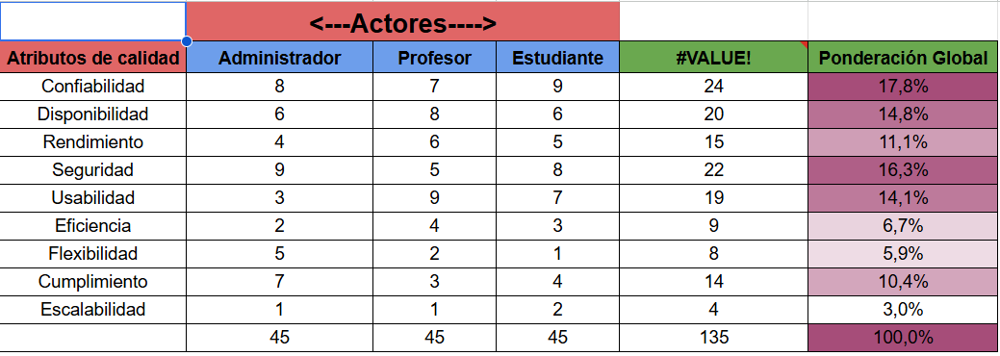
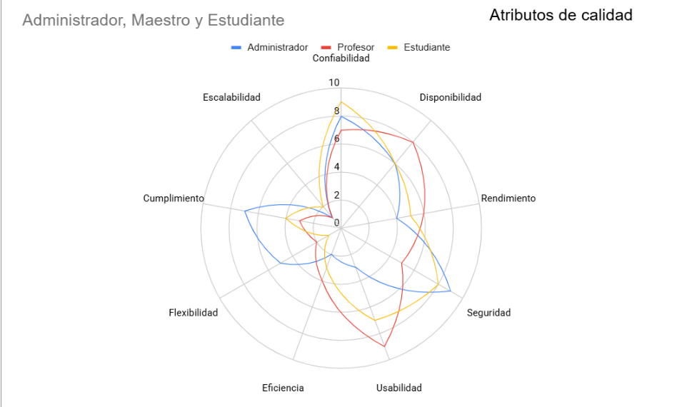
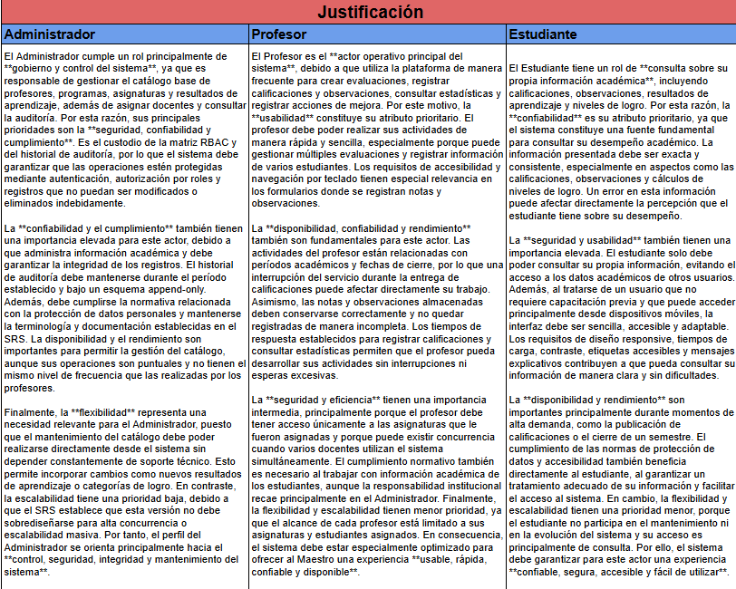
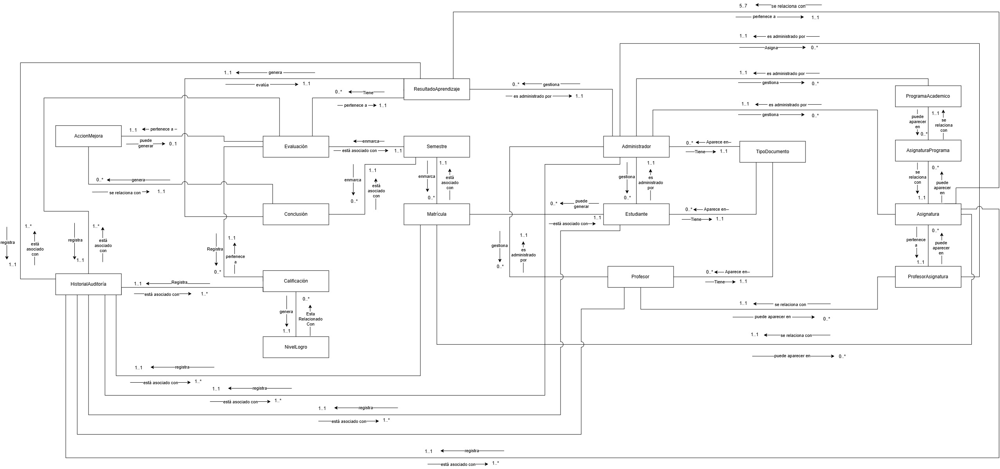
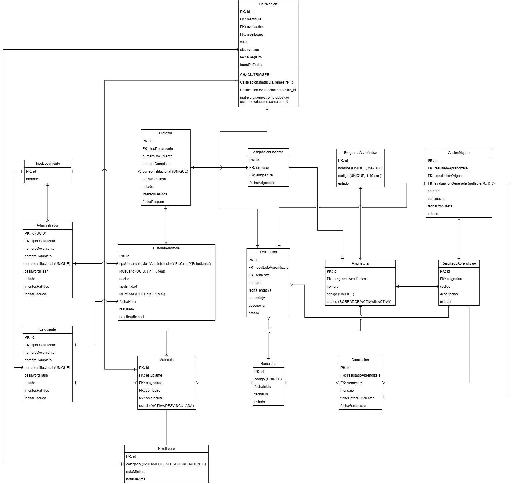

<div align="center">

# SIGRA

### Software Integral de Gestión de Resultados de Aprendizaje

**Backend**

Ingeniería de Software IV · Universidad Católica de Oriente
Equipo B · 2026

</div>

---

SIGRA es una plataforma web que permite a una institución educativa definir los Resultados
de Aprendizaje de sus asignaturas, evaluarlos, medir el nivel de logro alcanzado por los
estudiantes y cerrar el ciclo de mejora mediante conclusiones automáticas y acciones
correctivas.

Este repositorio contiene el **backend**: una API REST construida con Spring Boot 4 y
PostgreSQL. El frontend vive en un repositorio aparte.

| | |
| --- | --- |
| **Tecnologías** | Java 21 · Spring Boot 4.1.1 · PostgreSQL · Gradle |
| **Repositorio del frontend** | [software4-SIGRA-frontend](https://github.com/juancabernal/software4-SIGRA-frontend) |
| **Especificación de requisitos** | SRS del equipo, versión vigente |
| **Documentación de análisis y diseño** | [Ver índice](#documentación-del-proyecto) |

> **Cómo navegar este documento.** El índice enlaza a cada apartado. Al final de cada
> apartado de la documentación de análisis y diseño encontrarás una línea de navegación
> para ir al anterior, volver al índice o pasar al siguiente.

---

## Índice

- [1. Integrantes](#1-integrantes)
- [2. Propósito](#2-propósito)
- [3. Funcionalidad por integrante](#3-funcionalidad-por-integrante)
  - [Sprint 1 — Catálogo y seguridad (30/09/2026 – 05/10/2026)](#sprint-1--catálogo-y-seguridad-30092026--05102026)
  - [Sprint 2 — Operación académica (06/10/2026 – 12/10/2026)](#sprint-2--operación-académica-06102026--12102026)
  - [Sprint 3 — Cierre del ciclo y reportes (13/10/2026 – 19/10/2026)](#sprint-3--cierre-del-ciclo-y-reportes-13102026--19102026)
  - [Responsabilidades transversales](#responsabilidades-transversales)
- [4. Empaquetado](#4-empaquetado)
  - [Artefacto](#artefacto)
  - [Estructura de paquetes](#estructura-de-paquetes)
  - [Convención](#convención)
- [5. Arquitectura](#5-arquitectura)
  - [Vista general](#vista-general)
  - [Estilo arquitectónico](#estilo-arquitectónico)
  - [Capas](#capas)
  - [Decisiones transversales](#decisiones-transversales)
  - [Stack](#stack)
- [6. Cómo ejecutar el proyecto](#6-cómo-ejecutar-el-proyecto)
  - [Requisitos previos](#requisitos-previos)
  - [1. Clonar el repositorio](#1-clonar-el-repositorio)
  - [2. Crear el esquema de la base de datos](#2-crear-el-esquema-de-la-base-de-datos)
  - [3. Configurar las variables de entorno](#3-configurar-las-variables-de-entorno)
  - [4. Ejecutar en modo desarrollo](#4-ejecutar-en-modo-desarrollo)
    - [Autenticación (RF-04)](#autenticación-rf-04)
  - [5. Ejecutar las pruebas](#5-ejecutar-las-pruebas)
    - [Pruebas de la API con Bruno](#pruebas-de-la-api-con-bruno)
  - [6. Compilar y ejecutar el JAR](#6-compilar-y-ejecutar-el-jar)
  - [7. Conectar con el frontend](#7-conectar-con-el-frontend)
  - [Problemas frecuentes](#problemas-frecuentes)
- [RF-02 / RF-03 — Autenticación y autorización](#rf-02--rf-03--autenticación-y-autorización)
- [Pendientes conocidos del repositorio](#pendientes-conocidos-del-repositorio)
- [Documentación del proyecto](#documentación-del-proyecto)
  - [Documentos generales](#documentos-generales)
  - [Documentos de análisis y diseño](#documentos-de-análisis-y-diseño)
    - [Visión y estrategia](#visión-y-estrategia)
    - [Historias de usuario](#historias-de-usuario)
    - [Modelo de dominio](#modelo-de-dominio)
    - [Modelado de datos](#modelado-de-datos)
    - [Arquitectura y solución](#arquitectura-y-solución)
    - [Diagramas de clases y componentes](#diagramas-de-clases-y-componentes)
- [Flujo de trabajo con Git](#flujo-de-trabajo-con-git)
  - [Convención de commits](#convención-de-commits)

---

## 1. Integrantes

| Nombre | Rol en el proyecto | Correo |
| --- | --- | --- |
| Juan Camilo Bernal Carmona | Project Manager, Arquitecto y Desarrollador Backend | juan.bernal8928@uco.net.co |
| Jean Paul Ortiz Restrepo | Líder Técnico y Analista de Requisitos | jean.ortiz1424@uco.net.co |
| José Alejandro Valencia | Desarrollador Backend y Base de Datos | jose.valencia1373@uco.net.co |
| Simón Tabares Arias | Analista de Requisitos y Calidad (QA) | simon.tabares2225@uco.net.co |
| Juan José Narváez Marín | Ingeniero de Pruebas (QA/Testing) | juan.narvaez9044@uco.net.co |
| Santiago Torres Castaño | Diseñador UX/UI y Desarrollador Frontend | santiago.torres0381@uco.net.co |
| Andrés Felipe Vélez Alcaraz | Desarrollador Frontend | andres.velez5136@uco.net.co |

Docente y cliente del proyecto: **Luz Mery Ríos Alzate**.

---

## 2. Propósito

SIGRA permite que los profesores evalúen el aprendizaje de sus estudiantes tomando los **Resultados de Aprendizaje (RA)** de cada asignatura como unidad de medida, en lugar de la nota suelta por actividad.

Este repositorio contiene el **backend**: la API REST, el modelo de datos y las reglas de negocio que sostienen el ciclo central del sistema:

> **evaluar → analizar → mejorar → reevaluar**

El backend es responsable de:

- Autenticar usuarios y emitir los tokens de sesión (RF-02).
- Aplicar el control de acceso por rol en cada endpoint, según la Matriz RBAC del SRS (RF-03).
- Mantener el catálogo académico: programas, asignaturas, RA, profesores, estudiantes y semestres (RF-01 a RF-03, RF-06 a RF-09).
- Registrar evaluaciones, calificaciones y observaciones (RF-10 a RF-13).
- Calcular el nivel de logro y las estadísticas descriptivas con **lógica de agregación convencional, sin IA** (RF-14, RF-15).
- Generar conclusiones automáticas y gestionar acciones de mejora (RF-16 a RF-18).
- Conservar un historial de auditoría *append-only* (RF-19, RNF-16).

Queda fuera del alcance del MVP: uso de IA para el análisis, carga de rúbricas en PDF, pasarelas de pago e integraciones con sistemas académicos externos.

---

## 3. Funcionalidad por integrante

### Sprint 1 — Catálogo y seguridad (30/09/2026 – 05/10/2026)

| Integrante | Funcionalidad | Requisitos | Módulo |
| --- | --- | --- | --- |
| José Alejandro Valencia | Inicio de sesión: clase base `Usuario`, catálogo `TipoDocumento`, bcrypt factor 12, JWT HS256 de 60 min, bloqueo de 15 min tras 5 intentos fallidos | RF-02, RNF-10, RNF-17 | `auth` |
| José Alejandro Valencia | Control de acceso por roles: filtro JWT, roles ADMINISTRADOR/PROFESOR/ESTUDIANTE, 401 sin token y 403 sin permiso | RF-03, RNF-13 | `security` |
| Juan Camilo Bernal | Gestión de asignaturas: ciclo Borrador → Activa → Inactiva, código único, activación solo con 5 a 7 RA activos; al inactivar una asignatura se inactivan en cascada sus RA activos | RF-03a–d | `asignaturas` |
| Jean Paul Ortiz | Gestión de profesores: cédula de 6 a 10 dígitos, correo `@uco.net.co`, cédula no modificable, inactivación lógica | RF-01a–d | `profesores` |
| Juan José Narváez | Gestión de Resultados de Aprendizaje: código único por asignatura, tope de 7 RA, mínimo de 5 activos | RF-06a–c | `resultadosaprendizaje` |
| Simón Tabares | Gestión de programas académicos: CRUD con nombre y código únicos y eliminación lógica | RF-02a–d | `programas` |
| Santiago Torres | Gestión de semestres: código único, validación de fechas y rechazo de periodos solapados | RF-Semestre a/b | `semestres` |
| Andrés Vélez | Gestión de estudiantes: `Estudiante` extiende `Usuario`, documento y correo únicos | RF-09a | `estudiantes` |

### Sprint 2 — Operación académica (06/10/2026 – 12/10/2026)

| Integrante | Funcionalidad | Requisitos | Módulo |
| --- | --- | --- | --- |
| Jean Paul Ortiz | Asignación docente de asignaturas: asignación masiva, omisión informada de duplicados, servicio «asignaturas del profesor» | RF-07 | `profesores` |
| Andrés Vélez | Matrícula y desvinculación: unicidad (estudiante, asignatura, semestre), repitencia, conservación de calificaciones al desvincular | RF-08, RF-09 | `estudiantes` |
| Juan José Narváez | Gestión de evaluaciones: suma de porcentajes ≤ 100 por (RA, semestre), bloqueo de fecha y % si ya hay notas | RF-10, RF-11 | `evaluaciones` |
| Simón Tabares | Calificaciones y trazabilidad: nota 0.0–5.0, observación mínima de 10 caracteres, marca `fueraDeFecha` | RF-12, RF-13 | `calificaciones` |
| Santiago Torres | Nivel de logro y estadísticas: catálogo de 4 rangos, recálculo automático, umbral de 3 calificaciones | RF-14, RF-15 | `estadisticas` |
| Juan Camilo Bernal | Conclusiones automáticas: alerta cuando más del 40 % queda en Bajo o Medio, sin duplicar conclusiones vigentes | RF-16 | `estadisticas` |
| José Alejandro Valencia | Historial de auditoría: servicio `registrarEvento`, tabla sin UPDATE ni DELETE, reporte paginado para ADMINISTRADOR | RF-19, RF-21c | `auditoria` |

### Sprint 3 — Cierre del ciclo y reportes (13/10/2026 – 19/10/2026)

| Integrante | Funcionalidad | Requisitos | Módulo |
| --- | --- | --- | --- |
| Juan Camilo Bernal | Acciones de mejora y conversión a evaluación: registro solo con conclusión vigente, validación de % al convertir | RF-17, RF-18 | `mejoras` |
| Santiago Torres | Consultas y reportes por rol: vista del profesor, RA por asignatura, logro por programa, vista del estudiante | RF-20, RF-21a/b, RF-22 | `reportes` |

### Responsabilidades transversales

| Integrante | Responsabilidad |
| --- | --- |
| Jean Paul Ortiz | Setup del repositorio, entornos y pipeline CI |
| Juan José Narváez | Pruebas unitarias y de integración (cobertura ≥ 70 % con JaCoCo en autenticación, RBAC, nivel de logro y conclusiones) |
| Juan José Narváez y José Alejandro Valencia | Pruebas no funcionales (carga, tiempos de respuesta, seguridad) |
| Jean Paul Ortiz y José Alejandro Valencia | Despliegue final |
| Simón Tabares | Aceptación alfa y beta con la docente |
| Juan Camilo Bernal | Cierre y entrega final |

> Cada desarrollador documenta sus propios endpoints en Swagger; la consolidación es una tarea aparte del plan.

---

## 4. Empaquetado

### Artefacto

El proyecto se empaqueta con **Gradle** como un JAR ejecutable de Spring Boot (*fat jar*), que incluye el servidor embebido:

```bash
cd SIGRA
./gradlew clean bootJar
# → SIGRA/build/libs/SIGRA-0.0.1-SNAPSHOT.jar
```

### Estructura de paquetes

El código se organiza por **módulo de negocio** y, dentro de cada uno, por capa. Todos los módulos siguen exactamente la misma forma, de modo que cada integrante trabaja en su carpeta sin colisionar con los demás:

```
SIGRA/
├── build.gradle                  Dependencias y configuración de compilación
├── settings.gradle
├── gradlew / gradlew.bat         Gradle Wrapper
└── src/
    ├── main/
    │   ├── java/co/edu/uco/sigra/
    │   │   ├── SigraApplication.java      Punto de entrada
    │   │   ├── asignaturas/               RF-03
    │   │   ├── auditoria/                 RF-19, RF-21c
    │   │   ├── auth/                      RF-04
    │   │   ├── calificaciones/            RF-12, RF-13
    │   │   ├── estadisticas/              RF-14, RF-15, RF-16
    │   │   ├── estudiantes/               RF-08, RF-09
    │   │   ├── evaluaciones/              RF-10, RF-11
    │   │   ├── mejoras/                   RF-17, RF-18
    │   │   ├── profesores/                RF-01, RF-07
    │   │   ├── programas/                 RF-02
    │   │   ├── reportes/                  RF-20, RF-21a/b, RF-22
    │   │   ├── resultadosaprendizaje/     RF-06
    │   │   ├── semestres/                 RF-Semestre a/b
    │   │   ├── common/                    DTO, excepciones y utilidades compartidas
    │   │   ├── shared/                    Entidades y enums transversales (TipoDocumento, EstadoRegistro)
    │   │   ├── config/                    Configuración transversal
    │   │   └── security/                  RF-05: config y filtros JWT
    │   └── resources/
    │       └── application.yaml
    └── test/java/                Pruebas unitarias y de integración
```

Capas dentro de cada módulo:

| Carpeta | Contenido |
| --- | --- |
| `controller` | Endpoints REST; recibe y valida la petición |
| `dto` | Objetos de entrada y salida de la API |
| `entity` | Entidades JPA que mapean las tablas |
| `exception` | Excepciones propias del módulo |
| `mapper` | Conversión entre entidad y DTO |
| `repository` | Acceso a datos con Spring Data JPA |
| `service` / `service/impl` | Interfaz y reglas de negocio |

### Convención

Ninguna clase de `controller` accede directamente a `repository`: la ruta siempre es **controller → service → repository**. Las validaciones de negocio viven en `service/impl`, no en el controlador.

Los manejadores de excepciones de cada módulo atienden solo errores de negocio de ese módulo y NO incluyen un método para `Exception.class`; los errores comunes (validación, JSON ilegible, 403 por permisos, 500 genérico sin detalles técnicos) los atiende el manejador global en `common/exception`.

---

## 5. Arquitectura

### Vista general

```
┌──────────────────────┐        HTTPS / JSON        ┌──────────────────────────┐
│  SIGRA Frontend      │ ─────────────────────────▶ │  SIGRA Backend           │
│  Angular (SPA)       │ ◀───────────────────────── │  Spring Boot (API REST)  │
│  Admin / Profesor /  │      JWT en Authorization  │                          │
│  Estudiante          │                            └───────────┬──────────────┘
└──────────────────────┘                                        │ JDBC
                                                    ┌───────────▼──────────────┐
                                                    │  PostgreSQL              │
                                                    └──────────────────────────┘
```

SIGRA es un **sistema independiente**: no se integra con SIS, LMS ni pasarelas de pago.

### Estilo arquitectónico

- **Monolito modular por dominio.** Un solo despliegue, dividido internamente en módulos de negocio con fronteras claras. Dado el tamaño del proyecto (4 meses y ~20 usuarios), los microservicios serían sobrediseño.
- **Arquitectura en capas** dentro de cada módulo: controller → service → repository → entity.
- **API REST sin estado.** Cada petición lleva su JWT; el servidor no guarda sesión.

La arquitectura de seguridad definitiva y la integración de los módulos de `develop` están descritas
en [`docs/integracion/main-develop-definitiva-2026-10-16.md`](docs/integracion/main-develop-definitiva-2026-10-16.md).
No se mantienen interceptores ni identidades paralelas de desarrollo: los controladores usan
Spring Security y los servicios fallan cerradamente cuando falta el principal validado.

### Capas

| Capa | Responsabilidad | Tecnología |
| --- | --- | --- |
| Presentación | Endpoints REST, códigos HTTP, validación de entrada | Spring Web MVC, Jakarta Validation |
| Seguridad | Autenticación, filtro JWT, autorización por rol | Spring Security |
| Negocio | Reglas del dominio: rango de 5–7 RA, suma de % ≤ 100, nivel de logro, umbral del 40 % | Servicios Spring |
| Persistencia | Repositorios y mapeo objeto-relacional | Spring Data JPA / Hibernate |
| Datos | Almacenamiento con eliminación lógica y auditoría append-only | PostgreSQL |

### Decisiones transversales

- **Seguridad en dos niveles.** Ocultar una opción en la interfaz nunca basta: cada endpoint valida el rol en el backend según la Matriz RBAC (RF-05, RNF-13). Sin token o con token vencido → `401`; con rol insuficiente → `403`.
- **Nada se borra físicamente.** Programas, asignaturas, RA, profesores y usuarios conservan sus estados
  propios; una matrícula usa `ACTIVA` / `DESVINCULADA` y conserva sus calificaciones históricas.
- **Auditoría append-only.** La tabla de historial no admite `UPDATE` ni `DELETE`, ni siquiera para el administrador; la restricción se impone a nivel de base de datos. Retención mínima: 5 años (RNF-16).
- **Análisis sin IA.** Estadísticas y conclusiones se calculan con agregaciones y reglas de negocio explícitas.
- **Errores sin detalles técnicos.** Los mensajes al usuario no exponen trazas, rutas internas ni consultas SQL (RNF-17).

### Stack

| Componente | Tecnología | Versión |
| --- | --- | --- |
| Lenguaje | Java | 21 (toolchain) |
| Framework | Spring Boot | 4.1.1 |
| Build | Gradle (Wrapper) | — |
| Base de datos | PostgreSQL | 15 o superior |
| ORM | Spring Data JPA / Hibernate | — |
| Seguridad | Spring Security + JWT (HS256) | — |
| Bloqueo de intentos fallidos | Persistido en PostgreSQL (`usuario.intentos_fallidos`, `usuario.fecha_bloqueo`). Redis no se usa | — |
| Validación | Spring Boot Starter Validation | — |
| Monitoreo | Spring Boot Actuator (`/actuator/health`) | — |
| Reducción de boilerplate | Lombok | — |
| Mapeo entidad ↔ DTO | MapStruct | 1.6.3 |
| Pruebas | JUnit 5 + Mockito + MockMvc | — |
| Documentación de API | OpenAPI / Swagger (springdoc) | 3.1.1 |

---

## 6. Cómo ejecutar el proyecto

### Requisitos previos

| Herramienta | Versión mínima | Verificación |
| --- | --- | --- |
| JDK | 21 | `java -version` |
| PostgreSQL | 15 | `psql --version` |
| Redis | 7 — Opcional por ahora (deshabilitado temporalmente) | `redis-cli ping` |
| Git | 2.30 | `git --version` |

No hace falta instalar Gradle: el repositorio incluye el Wrapper (`gradlew`).

### 1. Clonar el repositorio

```bash
git clone https://github.com/juancabernal/software4-SIGRA-backend.git
cd software4-SIGRA-backend/SIGRA
```

> Todos los comandos siguientes se ejecutan desde la carpeta `SIGRA/`, que es la raíz del proyecto Gradle.

### 2. Crear el esquema de la base de datos

SIGRA usa la base `postgres` y el **schema** `sigra` dentro de ella. `sigra` **no es una base de datos**: por eso la URL JDBC lleva `?currentSchema=sigra`.

Para una base vacía, ejecuta el baseline (crea el schema y todas sus tablas en una sola transacción):

```bash
psql -h localhost -p <PUERTO> -U <USUARIO> -d postgres -v ON_ERROR_STOP=1 -f docs/db/SIGRA_SCHEMA_CURRENT.sql
```

Hibernate **no crea ni modifica tablas**: con `ddl-auto=validate` solo comprueba que las entidades coincidan con el esquema. Si falta una tabla o una columna, el backend no arranca. El detalle del modelo (herencia `Usuario` → `Profesor`, correo institucional, deudas) está en [docs/db/SIGRA_DATABASE_CURRENT.md](docs/db/SIGRA_DATABASE_CURRENT.md).

### 3. Configurar las variables de entorno

Nunca subas credenciales al repositorio. La forma recomendada es un archivo `.env` dentro de `SIGRA/`. Spring Boot lo carga de forma nativa (`spring.config.import`) y Git lo ignora (`*.env`):

```bash
cp .env.example .env
```

En PowerShell: `Copy-Item .env.example .env`. Después completa los valores. Las variables reales del sistema (por ejemplo `$env:DB_URL`) tienen prioridad sobre el archivo.

| Variable | Descripción | Valor por defecto | Ejemplo |
| --- | --- | --- | --- |
| `DB_URL` | URL JDBC: base `postgres` y schema `sigra` (`currentSchema`). El puerto depende de tu máquina. Sin valor por defecto | — | `jdbc:postgresql://localhost:5432/postgres?currentSchema=sigra` |
| `DB_USERNAME` | Usuario de la base de datos. Sin valor por defecto | — | `postgres` |
| `DB_PASSWORD` | Contraseña de la base de datos. Sin valor por defecto | — | — |
| `SERVER_PORT` | Puerto HTTP del backend | `8080` | `8080` |
| `JWT_SECRET` | Clave de firma HS256 de al menos 32 bytes. Sin valor por defecto | — | — |
| `JWT_EXPIRATION_MS` | Vigencia del token en milisegundos (debe ser mayor que cero) | `3600000` (60 min) | `3600000` |
| `CORS_ALLOWED_ORIGINS` | Orígenes del frontend, separados por coma | `http://localhost:4200` | `http://localhost:4200` |
| `JPA_DDL_AUTO` | Estrategia de Hibernate. `validate` solo comprueba el esquema; Hibernate nunca lo modifica | `validate` | `validate` |
| `JPA_SHOW_SQL` | Mostrar las consultas SQL en consola | `false` | `false` |

> **Puerto de PostgreSQL:** cada desarrollador usa el puerto de su propio servidor. Por ejemplo, en la máquina de referencia de este proyecto el servidor escucha en `localhost:5433`, así que allí `DB_URL` es `jdbc:postgresql://localhost:5433/postgres?currentSchema=sigra`. El puerto **no está fijado en el código**: se configura en `SIGRA/.env` o en las variables del sistema. El `.env.example` compartido muestra `5432`, que es el valor por defecto de PostgreSQL.

En Linux o macOS:

```bash
export DB_URL="jdbc:postgresql://localhost:5432/postgres?currentSchema=sigra"
export DB_USERNAME=postgres
export DB_PASSWORD=cambiar_esta_clave
export SERVER_PORT=8080
export JWT_SECRET=una_clave_larga_y_aleatoria_de_al_menos_32_caracteres
export JWT_EXPIRATION_MS=3600000
```

En Windows (PowerShell):

```powershell
$env:DB_URL="jdbc:postgresql://localhost:5432/postgres?currentSchema=sigra"
$env:DB_USERNAME="postgres"
$env:DB_PASSWORD="cambiar_esta_clave"
$env:SERVER_PORT="8080"
$env:JWT_SECRET="una_clave_larga_y_aleatoria_de_al_menos_32_caracteres"
$env:JWT_EXPIRATION_MS="3600000"
```

### 4. Ejecutar en modo desarrollo

Linux / macOS:

```bash
./gradlew bootRun
```

Windows:

```powershell
.\gradlew.bat bootRun
```

La API queda disponible en **http://localhost:8080**.

| Recurso | URL |
| --- | --- |
| Estado del servicio | http://localhost:8080/actuator/health |
| Documentación Swagger (UI) | http://localhost:8080/swagger-ui.html |
| Contrato OpenAPI (JSON) | http://localhost:8080/v3/api-docs |

Guías de documentación OpenAPI por módulo:

- [Autenticación JWT](docs/documentacion_openapi/swagger-autenticacion.md)
- [Historial de auditoría](docs/documentacion_openapi/swagger-auditoria.md)
- [Profesores](docs/documentacion_openapi/swagger-profesores.md), [Estudiantes](docs/documentacion_openapi/swagger-estudiantes.md) y [Matrículas](docs/documentacion_openapi/swagger-matriculas.md)

#### Autenticación (RF-04)

`POST /api/v1/auth/login` es público: no requiere token ni cabecera CSRF.

```json
{
  "correoInstitucional": "profesor.bruno@uco.net.co",
  "contrasena": "PasswordSeguro123*"
}
```

| Código | Cuándo |
| --- | --- |
| 200 | Credenciales válidas. Devuelve `token` (JWT HS256 con los claims `sub`, `correo`, `rol`, `iat`, `exp`), `tipo` (`Bearer`), `expiraEn` (segundos) y `usuario` |
| 400 | Datos inválidos: correo vacío o de otro dominio que no sea `@uco.net.co`, o contraseña vacía |
| 401 | Correo o contraseña incorrectos, o usuario inactivo. Es el mismo mensaje en todos los casos |
| 423 | Usuario bloqueado durante 15 minutos tras 5 intentos fallidos |

El correo se acepta sin distinguir mayúsculas y con espacios laterales; el servidor lo normaliza antes de buscarlo. El token vence a los 60 minutos.

### 5. Ejecutar las pruebas

```bash
./gradlew test                            # Pruebas unitarias y de capa web (sin PostgreSQL)
./gradlew integrationTest                 # Pruebas de integración (requiere PostgreSQL y SIGRA/.env)
./gradlew test --tests '*auth*'           # Solo las pruebas de un módulo (ejemplo)
./gradlew test jacocoTestReport           # Pruebas + reporte de cobertura (disponible cuando se agregue el plugin de JaCoCo)
```

Las pruebas se separan por etiqueta para saber siempre qué se ejecutó:

| Tarea | Qué incluye | Requiere PostgreSQL |
| --- | --- | --- |
| `test` | Unitarias y de capa web: servicios, entidades, JWT, BCrypt, controladores con MockMvc y la cadena de seguridad real (`SecurityConfig`) | No |
| `integrationTest` | Pruebas con `@Tag("integration")`: `SigraContextIT` levanta el contexto completo | Sí, con `.env` válido |

Las 5 pruebas de integración del módulo Asignaturas (casos, datos y limpieza con prefijo ITG) están en [docs/pruebas/asignaturas-integracion.md](docs/pruebas/asignaturas-integracion.md).

La matriz de pruebas de matrícula y la migración de `fecha_matricula`/`EstadoMatricula` están en
[`docs/pruebas/matricula-integracion.md`](docs/pruebas/matricula-integracion.md) y
[`docs/db/RF08_matricula_fecha_y_estado_migration.sql`](docs/db/RF08_matricula_fecha_y_estado_migration.sql).

Un fallo de `integrationTest` por credenciales o conexión no invalida el resultado de `test`.

El reporte de cobertura quedará en `build/reports/jacoco/test/html/index.html` cuando se agregue el plugin de JaCoCo.

#### Pruebas de la API con Bruno

Además de las pruebas unitarias, el repositorio incluye una colección de pruebas de la API para [Bruno](https://www.usebruno.com) en `bruno/SIGRA/`, con datos de prueba reproducibles. Cómo cargar los datos y ejecutarla: [bruno/README.md](bruno/README.md).

### 6. Compilar y ejecutar el JAR

```bash
./gradlew clean bootJar
java -jar build/libs/SIGRA-0.0.1-SNAPSHOT.jar
```

Para apuntar a otro perfil o puerto:

```bash
java -jar build/libs/SIGRA-0.0.1-SNAPSHOT.jar --spring.profiles.active=prod --server.port=9090
```

### 7. Conectar con el frontend

Levanta el backend en el puerto 8080 y luego el [frontend Angular](https://github.com/juancabernal/software4-SIGRA-frontend) en el 4200. El frontend apunta al backend mediante la variable `apiUrl` de sus archivos de entorno.

### Problemas frecuentes

| Síntoma | Causa probable | Solución |
| --- | --- | --- |
| `Connection refused` a PostgreSQL | El servicio no está arriba o el puerto es otro | Verifica el servicio y el valor de `DB_URL` |
| `Permission denied: ./gradlew` | El script perdió el permiso de ejecución | `chmod +x gradlew` |
| `UnsupportedClassVersionError` | JDK anterior a 21 | Instala JDK 21 y ajusta `JAVA_HOME` |
| `Could not resolve all dependencies` | Primera ejecución sin red o con proxy | Verifica la conexión y vuelve a ejecutar |
| El token se rechaza siempre | `JWT_SECRET` ausente o demasiado corto | Define una clave de 32 caracteres o más |
| `Could not resolve placeholder 'DB_URL'` (o `DB_USERNAME`, `DB_PASSWORD`, `JWT_SECRET`) | No existe `SIGRA/.env` ni la variable está definida en el sistema. Estas variables no tienen valor por defecto | Crea `SIGRA/.env` a partir de `.env.example` y completa los valores |
| `Schema-validation: missing table [...]` o `missing column [...]` al arrancar | La base no tiene el esquema que esperan las entidades (`ddl-auto=validate`) | Ejecuta `docs/db/SIGRA_SCHEMA_CURRENT.sql` en una base vacía, o la migración correspondiente en una base existente. Ver [SIGRA_DATABASE_CURRENT.md](docs/db/SIGRA_DATABASE_CURRENT.md) |
| `relation "usuario" does not exist` o `schema "sigra" does not exist` | `DB_URL` no apunta a `currentSchema=sigra` o el schema no fue creado | Revisa `DB_URL` y ejecuta el baseline |
| `Connection refused` en `localhost:5433` (o `5432`) | El puerto de `DB_URL` no coincide con el de tu PostgreSQL | Corrige el puerto en `DB_URL` dentro de `SIGRA/.env` |
| PowerShell no reconoce `gradlew` | En PowerShell hay que indicar la ruta del script | Ejecuta con `.\gradlew.bat` (con `.\`) |


---

## RF-02 / RF-03 — Autenticación y autorización

**Estado: COMPLETADO (backend para integración frontend).** La autenticación RF-02 y la autorización RBAC RF-03 están activas en la cadena HTTP y en los métodos de los controladores.

| Tecnología | Uso en RF-02/RF-03 |
| --- | --- |
| Spring Security | Cadena de filtros sin estado (`STATELESS`), CSRF deshabilitado para la API REST |
| BCrypt, factor 12 | Hash de contraseñas (`PasswordEncoder`). Nunca se expone el hash |
| JWT HS256 | Token de sesión firmado con `JWT_SECRET` |
| Spring Data JPA / PostgreSQL | Persistencia de `Usuario` (herencia JOINED con `Profesor`) y del contador de intentos |
| Swagger / OpenAPI | Documentación de la API |
| Bruno | Colección de pruebas de la API (`bruno/SIGRA/auth/`) |

**Endpoint:** `POST /api/v1/auth/login` (público).

| Regla | Valor |
| --- | --- |
| Vigencia del JWT | 60 minutos (`JWT_EXPIRATION_MS`, por defecto `3600000`) |
| Intentos fallidos antes de bloquear | 5 consecutivos |
| Duración del bloqueo | 15 minutos. Durante el bloqueo se responde 423 sin evaluar la contraseña |
| Persistencia del contador | Los fallos se guardan aunque la respuesta sea un error (`noRollbackFor`) |
| Mensajes de error | Amigables, sin trazas, SQL ni nombres internos de clases (RNF-17) |

Códigos de respuesta: 200 (login correcto), 400 (validación), 401 (credenciales/token), 403 (rol o alcance), 413 (login mayor de 16 KiB), 423 (bloqueo temporal), 500 (fallo inesperado) y 503 (persistencia no disponible).

**Documentación en ejecución** (con el backend en `localhost:8080`):

- Swagger UI: http://localhost:8080/swagger-ui.html
- Contrato OpenAPI: http://localhost:8080/v3/api-docs
- Estado del servicio: http://localhost:8080/actuator/health

**Variables necesarias:** `DB_URL`, `DB_USERNAME`, `DB_PASSWORD` y `JWT_SECRET` (sin valor por defecto). `JWT_EXPIRATION_MS`, `JPA_DDL_AUTO` y `JPA_SHOW_SQL` tienen valor por defecto. Ver la tabla de la sección 6.

**Notas:**

- Al arrancar, Spring puede mostrar `Using generated security password`. Es un aviso inocuo: SIGRA no usa `UserDetailsService`; la autenticación real es `AuthService` + `PasswordEncoder` + JWT.
- `SecurityConfig` exige autenticación para toda ruta privada (`anyRequest().authenticated()`); la autorización fina se declara con `@PreAuthorize` y el alcance por recurso se comprueba en servicios/repositorios. La etiqueta interna RF-05 de la rama no reemplaza la nomenclatura oficial RF-02/RF-03.

**Deudas que no bloquean RF-02/RF-03** (ver «Pendientes conocidos» más abajo): aprovisionamiento de contraseñas para usuarios creados por API, revocación inmediata de JWT y rate limiting distribuido. `AUTH_RUNTIME_ROLES` quedó resuelta: `Profesor`, `Administrador` y `Estudiante` extienden `Usuario`.

---

## Pendientes conocidos del repositorio

Estado de RF-02/RF-03 (autenticación y autorización) y lo que sigue abierto:

1. **Cédula modificable: contradicción documental.** El diagrama de clases indica que `(tipoDocumento, numeroDocumento)` es una identidad no modificable, pero el criterio de aceptación de RF-01c valida la cédula al modificarla. Mientras el equipo no lo unifique, `modificarProfesor` conserva el comportamiento actual: el número de documento no cambia y el tipo de documento sí.
2. **Concurrencia de intentos fallidos (resuelto).** La búsqueda de usuario aplica bloqueo pesimista y la suite de integración verifica que no se pierdan incrementos bajo concurrencia en PostgreSQL.
3. **Aprovisionamiento de contraseñas (`PASSWORD_PROVISIONING_FLOW`).** `POST /api/v1/profesores` y `POST /api/v1/estudiantes` no reciben contraseña, así que un profesor o un estudiante registrado por la API no puede iniciar sesión todavía (lo mismo aplica a los estudiantes migrados desde el diseño anterior). Decisión: el administrador asigna la contraseña mediante un endpoint propio, `PUT /api/v1/usuarios/{id}/contrasena` (RNF-10: nunca se devuelve ni se registra); pendiente de implementar. Para desarrollo se usan los seeds de Bruno.
4. **Roles en tiempo de ejecución (resuelto).** `Profesor`, `Administrador` y `Estudiante` extienden `Usuario`, así que los tres pueden autenticarse si tienen contraseña (ver el punto 3).
5. **Alineación de esquema.** Si una base tiene `profesor_asignatura` (modelo antiguo) en lugar de `asignacion_docente`, el preflight lo marca como `ALINEACION_ASIGNACIONES_REQUERIDA`. No se renombra ninguna tabla sin revisión del módulo de asignaciones. La base de referencia no lo tiene. Ver `docs/db/RF04_schema_preflight.sql`.
6. **Unicidad de (tipoDocumento, numeroDocumento).** El UNIQUE compuesto del diagrama no puede declararse solo en `profesor`, porque `tipo_documento_id` vive en `usuario`. Se verifica en la migración y en el servicio, pero no como restricción de base de datos.
7. **JaCoCo.** El plugin de cobertura todavía no está declarado, aunque el plan de pruebas exige un 70 % mínimo.
8. **Redis.** Está desactivado temporalmente: comentado en `build.gradle` y `docker-compose.yml`.
9. **Nomenclatura histórica.** La rama se llama `rf-05-security-rbac`, pero la trazabilidad oficial de esta entrega es RF-02 (autenticación) y RF-03 (autorización). El código activo ya exige JWT y aplica `@PreAuthorize`.

---

## Documentación del proyecto

### Documentos generales

| Documento | Ubicación |
| --- | --- |
| Especificación de Requisitos de Software (IEEE 830) | Documento del equipo, versión 2.0 corregida |
| Entendimiento del problema y requisitos funcionales | `docs/requisitos_funcionales/` |
| Matriz RBAC | Apéndice 4.1 del SRS |
| Matriz de compatibilidad de pruebas | Apéndice 4.2 del SRS |
| Plan de pruebas | TestLink |
| Integración definitiva main/develop | `docs/integracion/main-develop-definitiva-2026-10-16.md` |

### Documentos de análisis y diseño

Cada apartado corresponde a una hoja del archivo compartido `documentosAndres/Documentación SIGRA (2).xlsx`. El responsable indicado es quien debe completar aquí su parte (resumen, enlace al documento o archivo embebido); mientras tanto queda marcado como pendiente.

#### Visión y estrategia

##### Visión
**Responsable:** Por definir

_Pendiente de completar._

---
[Índice](#índice) · [Siguiente →](#trade-off)

##### Trade-Off
**Responsable:** Santiago Torres

_Pendiente de completar._

---
[← Visión](#visión) · [Índice](#índice) · [Siguiente →](#mapa-de-empatía)

##### Mapa de empatía
**Responsable:** Andrés Felipe Vélez

El mapa de empatía identifica a los tres actores del sistema (Administrador, Profesor y Estudiante) y pondera los atributos de calidad del SRS según la prioridad que cada uno le da, como insumo para las decisiones de arquitectura y de diseño de la interfaz.

**1. Actores y ponderación de atributos de calidad**

Cada actor calificó de 1 a 9 la importancia de los nueve atributos de calidad del SRS (confiabilidad, disponibilidad, rendimiento, seguridad, usabilidad, eficiencia, flexibilidad, cumplimiento y escalabilidad). La columna *Ponderación Global* normaliza la suma de las tres calificaciones de cada atributo sobre el total de 135 puntos posibles.



**2. Diagrama de radar**

El diagrama de radar compara visualmente el perfil de prioridades de los tres actores: el Administrador se concentra en seguridad y confiabilidad, el Profesor en disponibilidad y usabilidad, y el Estudiante en confiabilidad y seguridad.



**3. Justificación**

La justificación explica, actor por actor, por qué cada atributo de calidad ocupa esa prioridad según su rol en SIGRA:

- **Administrador:** rol de gobierno y control del sistema; prioriza seguridad, confiabilidad y cumplimiento como custodio de la Matriz RBAC y del historial de auditoría.
- **Profesor:** actor operativo principal; prioriza usabilidad, disponibilidad y rendimiento porque usa la plataforma con frecuencia para crear evaluaciones y registrar calificaciones.
- **Estudiante:** rol de consulta sobre su propia información académica; prioriza confiabilidad, seguridad y usabilidad para confiar en los datos que consulta.



---
[← Trade-Off](#trade-off) · [Índice](#índice) · [Siguiente →](#historias-de-usuario-1)

#### Historias de usuario

##### Historias de usuario
**Responsable:** Juan José Narváez

Las historias de usuario se gestionaron en Azure DevOps (Boards > Queries) del proyecto SIGRA. Se organizan en una épica y tres features, y cada historia conserva el identificador del requisito funcional (RF) del SRS que implementa. Sus criterios de aceptación están en el apartado [Criterios de aceptación](#criterios-de-aceptación).

**Épica y features**

- **Épica:** catalogo academico
- **Feature: catalogo académico.** Feature que agrupa la gestión de las entidades base sobre las cuales opera SIGRA: profesores, programas académicos, asignaturas, Resultados de Aprendizaje, asignación docente y matrícula de estudiantes. Es el cimiento sobre el cual se construye todo el ciclo de evaluación académica.
- **Feature: evaluación y analítica.** Feature que agrupa el ciclo completo de evaluación del aprendizaje: creación de evaluaciones, registro de calificaciones, cálculo automático del nivel de logro, estadísticas descriptivas, conclusiones automáticas, acciones de mejora y las consultas/reportes por rol. Es la implementación directa del ciclo evaluar→analizar→mejorar→revaluar de SIGRA.
- **Feature: Seguridad y plataforma base.** Feature que agrupa las capacidades transversales de la plataforma: autenticación de usuarios, control de acceso basado en roles (RBAC) y el historial de auditoría append-only. Aplican por igual a los tres roles del sistema (Administrador, Profesor, Estudiante) y a todos los módulos funcionales.

**Historias de usuario (38)**

| ID | Título | Historia de usuario |
| --- | --- | --- |
| RF-01a | Registrar profesor | Como Administrador, quiero registrar un nuevo profesor en la plataforma, para poder asignarlo posteriormente a una o varias asignaturas. |
| RF-01b | Consultar profesor | Como Administrador, quiero consultar el listado de profesores registrados, para conocer su información y estado actual dentro de la plataforma. |
| RF-01c | Modificar profesor | Como Administrador, quiero modificar la información de un profesor ya registrado, para mantener sus datos actualizados. |
| RF-01d | Inactivar profesor | Como Administrador, quiero inactivar un profesor registrado, para que deje de estar disponible para nuevas asignaciones docentes sin perder su historial de datos. |
| RF-02a | Registrar programa académico | Como Administrador, quiero registrar un nuevo programa académico, para poder asociarle asignaturas dentro de la plataforma. |
| RF-02b | Consultar programa académico | Como Administrador, quiero consultar el listado de programas académicos registrados, para conocer su información y estado actual. |
| RF-02c | Modificar programa académico | Como Administrador, quiero modificar la información de un programa académico ya registrado, para mantener sus datos actualizados. |
| RF-02d | Inactivar programa académico | Como Administrador, quiero inactivar un programa académico registrado, para que deje de estar disponible para nuevas asignaturas sin perder su historial de datos. |
| RF-03a | Registrar asignatura | Como Administrador, quiero registrar una nueva asignatura dentro de un programa académico, para poder asociarle posteriormente los Resultados de Aprendizaje correspondientes. |
| RF-03b | Consultar asignatura | Como Administrador, quiero consultar el listado de asignaturas registradas, para conocer su información, estado y los Resultados de Aprendizaje asociados a cada una. |
| RF-03c | Modificar asignatura | Como Administrador, quiero modificar la información de una asignatura ya registrada, para mantener sus datos actualizados. |
| RF-03d | Activar / Inactivar asignatura | Como Administrador, quiero activar o inactivar una asignatura, para controlar su disponibilidad para la asignación docente y la matrícula de estudiantes, respetando el mínimo y máximo de Resultados de Aprendizaje requeridos. |
| RF-04 | Autenticación | Como usuario del sistema (Administrador, Profesor o Estudiante), quiero iniciar sesión con mis credenciales, para acceder de forma segura a las funcionalidades correspondientes a mi rol. |
| RF-05 | Control de acceso basado en roles (RBAC) | Como sistema, quiero validar los permisos de cada usuario en cada endpoint del backend según su rol (Administrador, Profesor o Estudiante), para garantizar que ninguno pueda acceder a funcionalidades o datos que no le correspondan, incluso si intenta manipular la interfaz. |
| RF-06a | Registrar Resultado de Aprendizaje | Como Administrador, quiero registrar un nuevo Resultado de Aprendizaje asociado a una asignatura, para definir sobre qué se evaluará el aprendizaje de los estudiantes en esa materia. |
| RF-06b | Consultar Resultado de Aprendizaje | Como Administrador o Profesor, quiero consultar los Resultados de Aprendizaje de una asignatura, para conocer sobre qué se está evaluando el aprendizaje de los estudiantes. |
| RF-06c | Modificar / Inactivar Resultado de Aprendizaje | Como Administrador, quiero modificar o inactivar un Resultado de Aprendizaje existente, para mantener actualizado el catálogo académico, siendo el único rol autorizado para hacerlo. |
| RF-07 | Asignación docente de asignaturas | Como Administrador, quiero asignar uno o varios profesores a una o varias asignaturas, para que puedan gestionar la evaluación del aprendizaje en ellas. |
| RF-08a | Matricular estudiante | Como Administrador o Profesor, quiero matricular un estudiante en una asignatura, para que pueda ser evaluado en los Resultados de Aprendizaje correspondientes. |
| RF-08b | Desvincular estudiante | Como Administrador o Profesor, quiero desvincular un estudiante de una asignatura, para reflejar que ya no continúa cursándola. |
| RF-09 | Registrar estudiante nuevo (por el docente) | Como Profesor, quiero registrar un estudiante nuevo con sus datos completos y matricularlo en mi asignatura, para poder evaluarlo sin depender de que el Administrador lo haga primero. |
| RF-10a | Crear evaluación | Como Profesor, quiero crear una evaluación asociada a un Resultado de Aprendizaje de mi asignatura, para poder medir el desempeño de los estudiantes en ese RA. |
| RF-10b | Modificar evaluación | Como Profesor, quiero modificar una evaluación existente, para corregir o actualizar su información antes o durante su aplicación. |
| RF-10c | Activar / Inactivar evaluación | Como Profesor, quiero activar o inactivar una evaluación, para controlar si está disponible para el registro de calificaciones. |
| RF-12 | Registro de calificaciones y observaciones | Como Profesor, quiero registrar la calificación y observación de un estudiante en una evaluación, para dejar constancia de su desempeño y justificar la nota asignada. |
| RF-14 | Cálculo de nivel de logro | Como Profesor, quiero que el sistema calcule automáticamente el nivel de logro de cada estudiante en un Resultado de Aprendizaje, para conocer su desempeño sin tener que calcularlo manualmente. |
| RF-15 | Estadísticas descriptivas | Como Profesor, quiero consultar estadísticas descriptivas del desempeño de mis estudiantes en un Resultado de Aprendizaje, para identificar patrones generales de aprendizaje en el grupo. |
| RF-16 | Conclusiones automáticas | Como Profesor, quiero que el sistema genere automáticamente una conclusión cuando el desempeño de mis estudiantes en un Resultado de Aprendizaje sea insuficiente, para identificar oportunamente en qué RA se requiere una acción de mejora. |
| RF-17 | Registro de acciones de mejora | Como Profesor, quiero registrar una acción de mejora para un Resultado de Aprendizaje con una conclusión insuficiente vigente, para atender el problema de aprendizaje detectado en mis estudiantes. |
| RF-18 | Conversión de Acción de Mejora a nueva Evaluación | Como Profesor, quiero convertir una Acción de Mejora en una nueva evaluación, para volver a medir el desempeño de los estudiantes en el mismo Resultado de Aprendizaje después de aplicar la mejora, cerrando así el ciclo evaluar-analizar-mejorar-revaluar. |
| RF-19 | Conservación de historial/auditoría | Como sistema, quiero registrar de forma permanente e inalterable los eventos relevantes ocurridos sobre las entidades académicas, para garantizar la trazabilidad y el cumplimiento del periodo mínimo de retención definido. |
| RF-20 | Consulta para Profesores | Como Profesor, quiero consultar una vista consolidada de mis asignaturas, para tener una visión general y rápida del estado de mis evaluaciones, calificaciones y Resultados de Aprendizaje sin tener que revisar cada módulo por separado. |
| RF-21a | Reporte de RA por asignatura | Como Administrador, quiero consultar un reporte de los Resultados de Aprendizaje por asignatura, para supervisar cómo está estructurado el catálogo académico en términos de evaluación. |
| RF-21b | Reporte de logro por programa | Como Administrador, quiero consultar un reporte del nivel de logro agregado por programa académico, para supervisar el desempeño general de los estudiantes a nivel institucional. |
| RF-21c | Reporte de historial completo | Como Administrador, quiero consultar el reporte del historial completo de auditoría, para supervisar los eventos y cambios ocurridos en el sistema. |
| RF-22 | Consulta para Estudiantes | Como Estudiante, quiero consultar mis propias calificaciones, observaciones, Resultados de Aprendizaje y niveles de logro, para conocer mi desempeño académico de forma clara y directa. |
| RF-23a | Registrar semestre | Como Administrador, quiero registrar un nuevo semestre académico, para poder asociar matrículas y evaluaciones a un periodo específico. |
| RF-23b | Consultar semestre | Como Administrador o Profesor, quiero consultar los semestres registrados, para conocer cuál está vigente y poder asociar matrículas o evaluaciones al periodo correcto. |

---
[← Mapa de empatía](#mapa-de-empatía) · [Índice](#índice) · [Siguiente →](#criterios-de-aceptación)

##### Criterios de aceptación
**Responsable:** Juan José Narváez

Cada historia de usuario tiene criterios de aceptación escritos en formato *Dado que… cuando… entonces…*. Se agrupan por el identificador de la historia definida en el apartado [Historias de usuario](#historias-de-usuario-1).

**RF-01a — Registrar profesor**

1. Dado que el Administrador ingresa un correo electrónico, cuando el dominio no corresponde a @uco.net.co, entonces el sistema rechaza el registro y muestra un mensaje de error.
2. Dado que el Administrador ingresa un número de cédula, cuando este tiene menos de 6 o más de 10 dígitos, entonces el sistema rechaza el registro y muestra un mensaje de error.
3. Dado que todos los campos obligatorios son válidos, cuando el Administrador confirma el registro, entonces el profesor queda creado con estado Activo y disponible para ser asignado a asignaturas.

**RF-01b — Consultar profesor**

1. Dado que existen profesores registrados, cuando el Administrador accede al listado, entonces el sistema muestra nombre, correo, número de documento y estado de cada uno.
2. Dado que el Administrador busca un profesor por nombre o número de documento, cuando el término de búsqueda coincide con un registro, entonces el sistema muestra el profesor correspondiente.
3. Dado que no existen profesores registrados, cuando el Administrador accede al listado, entonces el sistema muestra un estado vacío indicando que no hay registros.

**RF-01c — Modificar profesor**

1. Dado que el Administrador edita el correo electrónico de un profesor, cuando el nuevo valor no cumple el dominio @uco.net.co, entonces el sistema rechaza el cambio y muestra un mensaje de error.
2. Dado que el Administrador intenta modificar el número de documento de un profesor ya registrado, entonces el sistema rechaza el cambio y muestra un mensaje indicando que ese campo no es modificable.
3. Dado que los datos modificados son válidos, cuando el Administrador confirma los cambios, entonces el sistema actualiza la información del profesor y lo refleja inmediatamente en el listado de consulta.

**RF-01d — Inactivar profesor**

1. Dado que el Administrador selecciona un profesor activo, cuando confirma la inactivación, entonces el sistema cambia su estado a Inactivo sin eliminar físicamente el registro.
2. Dado que un profesor está inactivo, cuando el Administrador intenta asignarlo a una nueva asignatura, entonces el sistema no lo muestra como opción disponible.
3. Dado que un profesor inactivo tenía asignaturas ya asignadas previamente, cuando se consulta el historial de esas asignaturas, entonces la información del profesor y su participación se sigue mostrando correctamente.
4. Dado que un profesor tiene asignaturas activas asociadas, cuando el Administrador intenta inactivarlo, entonces el sistema rechaza la inactivación y muestra un mensaje indicando el motivo.

**RF-02a — Registrar programa académico**

1. Dado que el Administrador ingresa un nombre de programa académico, cuando ya existe otro programa con el mismo nombre, entonces el sistema rechaza el registro y muestra un mensaje de error.
2. Dado que el Administrador ingresa un código de programa académico, cuando ya existe otro programa con el mismo código, entonces el sistema rechaza el registro y muestra un mensaje de error.
3. Dado que el nombre y el código son únicos y válidos, cuando el Administrador confirma el registro, entonces el programa académico queda creado con estado Activo.

**RF-02b — Consultar programa académico**

1. Dado que existen programas académicos registrados, cuando el Administrador accede al listado, entonces el sistema muestra nombre, código y estado de cada uno.
2. Dado que el Administrador busca un programa por nombre o código, cuando el término de búsqueda coincide con un registro, entonces el sistema muestra el programa correspondiente.
3. Dado que no existen programas académicos registrados, cuando el Administrador accede al listado, entonces el sistema muestra un estado vacío indicando que no hay registros.

**RF-02c — Modificar programa académico**

1. Dado que el Administrador edita el nombre de un programa académico, cuando el nuevo nombre ya pertenece a otro programa existente, entonces el sistema rechaza el cambio y muestra un mensaje de error.
2. Dado que el Administrador edita el código de un programa académico, cuando el nuevo código ya pertenece a otro programa existente, entonces el sistema rechaza el cambio y muestra un mensaje de error.
3. Dado que los datos modificados son válidos, cuando el Administrador confirma los cambios, entonces el sistema actualiza la información del programa académico y lo refleja inmediatamente en el listado de consulta.

**RF-02d — Inactivar programa académico**

1. Dado que el Administrador selecciona un programa académico activo, cuando confirma la inactivación, entonces el sistema cambia su estado a Inactivo sin eliminar físicamente el registro.
2. Dado que un programa académico está inactivo, cuando el Administrador intenta crear una nueva asignatura asociada a él, entonces el sistema no lo muestra como opción disponible.
3. Dado que un programa académico inactivo tenía asignaturas ya creadas previamente, cuando se consulta el historial de esas asignaturas, entonces la información del programa sigue mostrándose correctamente.

**RF-03a — Registrar asignatura**

1. Dado que el Administrador ingresa el nombre y código de una asignatura, cuando el código ya pertenece a otra asignatura existente, entonces el sistema rechaza el registro y muestra un mensaje de error.
2. Dado que el Administrador confirma el registro de una nueva asignatura, cuando no ha seleccionado un programa académico al cual asociarla, entonces el sistema no permite guardar el registro.
3. Dado que los datos ingresados son válidos, cuando el Administrador confirma el registro, entonces la asignatura queda creada con estado Borrador (no puede quedar en estado Activa hasta tener entre 5 y 7 RA registrados).

**RF-03b — Consultar asignatura**

1. Dado que existen asignaturas registradas, cuando el Administrador accede al listado, entonces el sistema muestra nombre, código, programa académico, estado y cantidad de RA asociados.
2. Dado que el Administrador busca una asignatura por nombre o código, cuando el término coincide con un registro, entonces el sistema muestra la asignatura correspondiente.
3. Dado que el Administrador filtra asignaturas por programa académico, cuando selecciona un programa, entonces el sistema muestra únicamente las asignaturas asociadas a ese programa.
4. Dado que no existen asignaturas registradas, cuando el Administrador accede al listado, entonces el sistema muestra un estado vacío indicando que no hay registros.

**RF-03c — Modificar asignatura**

1. Dado que el Administrador edita el código de una asignatura, cuando el nuevo código ya pertenece a otra asignatura existente, entonces el sistema rechaza el cambio y muestra un mensaje de error.
2. Dado que el Administrador intenta asociar la asignatura a un programa académico inactivo, cuando confirma el cambio, entonces el sistema no permite la asociación.
3. Dado que los datos modificados son válidos, cuando el Administrador confirma los cambios, entonces el sistema actualiza la información de la asignatura y lo refleja inmediatamente en el listado de consulta.

**RF-03d — Activar / Inactivar asignatura**

1. Dado que una asignatura tiene menos de 5 Resultados de Aprendizaje registrados, cuando el Administrador intenta activarla, entonces el sistema rechaza la activación y muestra un mensaje indicando el mínimo requerido.
2. Dado que una asignatura tiene más de 7 Resultados de Aprendizaje registrados, cuando el Administrador intenta activarla, entonces el sistema rechaza la activación y muestra un mensaje indicando el máximo permitido.
3. Dado que una asignatura tiene entre 5 y 7 Resultados de Aprendizaje registrados, cuando el Administrador confirma la activación, entonces el sistema cambia su estado de Borrador a Activa.
4. Dado que una asignatura se encuentra en estado Activa, cuando el Administrador la inactiva, entonces el sistema cambia su estado a Inactiva sin eliminar el registro ni afectar las matrículas o calificaciones ya existentes.

**RF-04 — Autenticación**

1. Dado que un usuario ingresa correo y contraseña válidos, cuando confirma el inicio de sesión, entonces el sistema le da acceso según los permisos de su rol.
2. Dado que un usuario ingresa una contraseña incorrecta, cuando confirma el inicio de sesión, entonces el sistema rechaza el acceso, muestra un mensaje de error y registra el intento fallido.
3. Dado que un usuario acumula 5 intentos fallidos consecutivos, cuando realiza un sexto intento, entonces el sistema bloquea la cuenta durante 15 minutos e informa del bloqueo.
4. Dado que una cuenta está bloqueada, cuando el usuario intenta iniciar sesión antes de que transcurran los 15 minutos, entonces el sistema rechaza el acceso e indica el tiempo restante.
5. Dado que han transcurrido los 15 minutos de bloqueo, cuando el usuario inicia sesión con credenciales correctas, entonces el sistema permite el acceso y reinicia el contador de intentos fallidos.
6. Dado que un usuario inicia sesión correctamente, cuando el sistema genera el token de sesión, entonces este debe expirar a los 60 minutos conforme a la política de seguridad.

**RF-05 — Control de acceso basado en roles (RBAC)**

1. Dado que un Estudiante intenta acceder a un endpoint exclusivo de Administrador o Profesor, cuando realiza la solicitud (aunque no la vea disponible en la interfaz), entonces el backend rechaza la solicitud con un error de autorización.
2. Dado que un Profesor intenta consultar o modificar datos de una asignatura que no tiene asignada, cuando realiza la solicitud, entonces el backend rechaza la solicitud con un error de autorización.
3. Dado que un Administrador accede a las funcionalidades de gestión del catálogo académico, cuando realiza cualquier operación permitida por su rol, entonces el sistema le da acceso sin restricciones adicionales.
4. Dado que un Estudiante consulta sus propios datos (notas, RA, niveles de logro), cuando realiza la solicitud, entonces el sistema le muestra únicamente su información, sin datos agregados ni de otros estudiantes.
5. Dado que se define la Matriz RBAC (Apéndice 4.1 del SRS), cuando se implementa cada endpoint del backend, entonces la validación de permisos debe corresponder exactamente a lo definido en dicha matriz, sin depender únicamente de ocultar opciones en el frontend.

**RF-06a — Registrar Resultado de Aprendizaje**

1. Dado que una asignatura ya tiene 7 Resultados de Aprendizaje registrados, cuando el Administrador intenta registrar uno adicional, entonces el sistema rechaza el registro indicando que se alcanzó el máximo permitido.
2. Dado que el Administrador ingresa la descripción de un nuevo RA, cuando confirma el registro, entonces el sistema lo asocia correctamente a la asignatura seleccionada con estado Activo.
3. Dado que el Administrador intenta registrar un RA sin seleccionar una asignatura, cuando confirma el registro, entonces el sistema no permite guardar el RA.

**RF-06b — Consultar Resultado de Aprendizaje**

1. Dado que el usuario es Administrador, cuando accede al listado de RA, entonces el sistema muestra todos los RA de todas las asignaturas, sin restricción.
2. Dado que el usuario es Profesor, cuando accede al listado de RA, entonces el sistema muestra únicamente los RA de las asignaturas que tiene asignadas.
3. Dado que una asignatura tiene RA registrados, cuando se consulta el listado, entonces el sistema muestra descripción y estado de cada RA.
4. Dado que una asignatura no tiene RA registrados, cuando se consulta el listado, entonces el sistema muestra un estado vacío indicando que no hay registros.

**RF-06c — Modificar / Inactivar Resultado de Aprendizaje**

1. Dado que un Profesor intenta modificar o inactivar un RA, cuando realiza la solicitud, entonces el sistema rechaza la operación por no tener los permisos correspondientes (según RBAC).
2. Dado que el Administrador edita la descripción de un RA, cuando confirma los cambios, entonces el sistema actualiza la información y la refleja inmediatamente en la consulta.
3. Dado que el Administrador inactiva un RA, cuando este ya tiene evaluaciones y calificaciones asociadas, entonces el sistema cambia su estado a Inactivo sin eliminar el registro ni afectar el historial existente.
4. Dado que el Administrador intenta inactivar un RA y la asignatura quedaría con menos de 5 RA activos, cuando confirma la inactivación, entonces el sistema advierte que la asignatura podría no cumplir el mínimo requerido para mantenerse Activa.

**RF-07 — Asignación docente de asignaturas**

1. Dado que el Administrador selecciona uno o varios profesores y una o varias asignaturas, cuando confirma la asignación, entonces el sistema crea la relación correspondiente entre cada profesor y cada asignatura seleccionada.
2. Dado que el Administrador intenta asignar un profesor a una asignatura donde ya está asignado, cuando confirma la operación, entonces el sistema omite esa asignación duplicada y continúa con las demás sin generar error.
3. Dado que se omiten asignaciones duplicadas durante el proceso, cuando la operación finaliza, entonces el sistema informa al Administrador cuáles asignaciones fueron omitidas por duplicidad.
4. Dado que el Administrador intenta asignar un profesor inactivo o una asignatura inactiva, cuando confirma la operación, entonces el sistema rechaza esa asignación específica.

**RF-08a — Matricular estudiante**

1. Dado que se selecciona un estudiante, una asignatura y un semestre, cuando se confirma la matrícula, entonces el sistema crea la relación con estado Activa, asociada a ese semestre.
2. Dado que un estudiante ya está matriculado y activo en una asignatura dentro del mismo semestre, cuando se intenta matricularlo de nuevo en esa combinación, entonces el sistema rechaza la operación por matrícula duplicada.
3. Dado que un estudiante ya cursó una asignatura en un semestre anterior, cuando se le matricula de nuevo en esa misma asignatura pero en un semestre distinto (ej. repitencia), entonces el sistema sí permite crear la nueva matrícula, sin considerarla duplicada.
4. Dado que se intenta matricular en una asignatura inactiva, cuando se confirma la operación, entonces el sistema rechaza la matrícula.

**RF-08b — Desvincular estudiante**

1. Dado que un estudiante matriculado no tiene calificaciones registradas en la asignatura, cuando se confirma la desvinculación, entonces el sistema cambia el estado de la matrícula a Desvinculada directamente.
2. Dado que un estudiante matriculado ya tiene calificaciones registradas en la asignatura, cuando se intenta desvincularlo, entonces el sistema solicita una confirmación adicional antes de proceder.
3. Dado que se confirma la desvinculación de un estudiante con calificaciones existentes, cuando se completa la operación, entonces el sistema cambia el estado a Desvinculada sin eliminar las calificaciones ya registradas.

**RF-09 — Registrar estudiante nuevo (por el docente)**

1. Dado que el Profesor ingresa los datos completos de un estudiante nuevo (nombre, documento, correo, etc.), cuando confirma el registro, entonces el sistema crea el estudiante y lo matricula automáticamente en la asignatura del profesor.
2. Dado que el Profesor intenta registrar un estudiante con un número de documento ya existente en el sistema, cuando confirma el registro, entonces el sistema rechaza la operación e indica que el estudiante ya existe.
3. Dado que los datos ingresados no cumplen las validaciones de formato (correo, documento), cuando el Profesor confirma el registro, entonces el sistema rechaza la operación y muestra el error correspondiente.

**RF-10a — Crear evaluación**

1. Dado que el Profesor ingresa nombre, fecha tentativa, porcentaje y descripción de la evaluación, cuando confirma el registro, entonces el sistema crea la evaluación asociada al RA seleccionado con estado Activa.
2. Dado que la suma de los porcentajes de las evaluaciones ya existentes para ese RA en ese mismo semestre, más el porcentaje de la nueva evaluación supera el 100%, cuando el Profesor confirma el registro, entonces el sistema rechaza la creación y muestra un mensaje de error.
3. Dado que el Profesor intenta crear una evaluación sobre un RA que no pertenece a una de sus asignaturas asignadas, cuando realiza la solicitud, entonces el sistema rechaza la operación (validado por RBAC).
4. Dado que el Profesor no completa alguno de los campos obligatorios (nombre, fecha tentativa, porcentaje), cuando confirma el registro, entonces el sistema no permite guardar la evaluación.
5. Dado que un RA tiene evaluaciones de un semestre anterior que ya suman 100%, cuando el Profesor crea una nueva evaluación para ese mismo RA pero en un semestre distinto, entonces el sistema permite el registro — la validación de suma es independiente por semestre.

**RF-10b — Modificar evaluación**

1. Dado que una evaluación no tiene calificaciones registradas, cuando el Profesor edita cualquiera de sus atributos (nombre, fecha, porcentaje, descripción), entonces el sistema permite el cambio sin restricción.
2. Dado que una evaluación ya tiene al menos una calificación registrada, cuando el Profesor intenta modificar la fecha tentativa o el porcentaje, entonces el sistema bloquea esos dos campos específicos y no permite su edición.
3. Dado que una evaluación ya tiene calificaciones registradas, cuando el Profesor edita el nombre o la descripción, entonces el sistema permite el cambio sin restricción (solo fecha y porcentaje quedan bloqueados).
4. Dado que la modificación del porcentaje (cuando es editable) haría que la suma de porcentajes del RA supere el 100%, cuando el Profesor confirma el cambio, entonces el sistema rechaza la modificación.

**RF-10c — Activar / Inactivar evaluación**

1. Dado que una evaluación se encuentra en estado Activa, cuando el Profesor la inactiva, entonces el sistema cambia su estado a Inactiva y deja de estar disponible para nuevos registros de calificación.
2. Dado que una evaluación ya tiene calificaciones registradas, cuando el Profesor la inactiva, entonces las calificaciones existentes no se eliminan ni se ven afectadas.
3. Dado que una evaluación se encuentra en estado Inactiva, cuando el Profesor la reactiva, entonces el sistema cambia su estado a Activa nuevamente.

**RF-12 — Registro de calificaciones y observaciones**

1. Dado que el Profesor ingresa una nota, cuando el valor está fuera del rango 0.0 a 5.0, entonces el sistema rechaza el registro y muestra un mensaje de error.
2. Dado que el Profesor registra una calificación, cuando no ingresa una observación, entonces el sistema no permite guardar el registro (la observación es obligatoria).
3. Dado que el Profesor ingresa una observación, cuando esta tiene menos de 10 caracteres, entonces el sistema rechaza el registro y muestra un mensaje indicando el mínimo requerido.
4. Dado que la nota y la observación cumplen todas las validaciones, cuando el Profesor confirma el registro, entonces el sistema guarda la calificación asociada al estudiante y a la evaluación correspondiente.
5. Dado que el Profesor registra una calificación en una fecha posterior a la fecha tentativa de la evaluación, cuando confirma el registro, entonces el sistema muestra un ícono de advertencia (⚠) junto al registro.
6. Dado que se registra una calificación fuera de la fecha tentativa de la evaluación, cuando se completa el registro, entonces el sistema deja constancia de este evento en el historial de auditoría.
7. Dado que el Profesor intenta registrar una calificación para un estudiante que no está matriculado (o cuya matrícula está Desvinculada) en la asignatura, cuando confirma el registro, entonces el sistema rechaza la operación.
8. Dado que el Profesor intenta modificar una calificación ya registrada, cuando confirma el cambio, entonces el sistema actualiza el valor y también deja constancia del cambio en el historial de auditoría (append-only, sin sobrescribir el registro original).
9. Dado que el sistema va a registrar una calificación, cuando el semestre de la matrícula del estudiante en esa asignatura es distinto al semestre de la evaluación, entonces el sistema rechaza el registro — no se puede calificar a un estudiante en una evaluación de un periodo distinto al de su matrícula.

**RF-14 — Cálculo de nivel de logro**

1. Dado que un estudiante tiene calificaciones registradas en un RA, cuando el sistema calcula su nivel de logro, entonces asigna Bajo si el resultado está entre 0.0 y 2.9.
2. Dado que un estudiante tiene calificaciones registradas en un RA, cuando el sistema calcula su nivel de logro, entonces asigna Medio si el resultado está entre 3.0 y 3.9.
3. Dado que un estudiante tiene calificaciones registradas en un RA, cuando el sistema calcula su nivel de logro, entonces asigna Alto si el resultado está entre 4.0 y 4.5.
4. Dado que un estudiante tiene calificaciones registradas en un RA, cuando el sistema calcula su nivel de logro, entonces asigna Sobresaliente si el resultado está entre 4.6 y 5.0.
5. Dado que un estudiante no tiene ninguna calificación registrada en un RA, cuando se consulta su nivel de logro, entonces el sistema muestra el estado "Sin evaluar" en lugar de una categoría numérica.
6. Dado que se registra una nueva calificación para un estudiante en un RA, cuando el registro se guarda, entonces el sistema recalcula automáticamente el nivel de logro correspondiente sin requerir acción manual del Profesor.
7. Dado que se consulta el nivel de logro de un estudiante, cuando el sistema lo muestra, entonces lo presenta siempre con texto e ícono (nunca solo con color), conforme a la guía de accesibilidad definida.
8. Dado que un estudiante cursó la misma asignatura en dos semestres distintos (repitencia), cuando se consulta su nivel de logro en un RA, entonces el sistema distingue el nivel de logro correspondiente a cada semestre por separado, sin mezclarlos.

**RF-15 — Estadísticas descriptivas**

1. Dado que un RA tiene al menos 3 calificaciones registradas entre los estudiantes matriculados, cuando el Profesor consulta las estadísticas, entonces el sistema calcula y muestra los datos descriptivos correspondientes (ej. promedio, distribución por nivel de logro).
2. Dado que un RA tiene menos de 3 calificaciones registradas, cuando el Profesor intenta consultar las estadísticas, entonces el sistema muestra el mensaje "Datos insuficientes" en lugar de generar el cálculo.
3. Dado que se consultan las estadísticas de un RA con datos suficientes, cuando se genera el resultado, entonces el sistema muestra la distribución de estudiantes por cada nivel de logro (Bajo, Medio, Alto, Sobresaliente).
4. Dado que un Profesor intenta consultar estadísticas de un RA que no pertenece a una de sus asignaturas asignadas, cuando realiza la solicitud, entonces el sistema rechaza la operación (validado por RBAC).

**RF-16 — Conclusiones automáticas**

1. Dado que un RA tiene datos suficientes para estadísticas (mínimo 3 calificaciones), cuando más del 40% de los estudiantes matriculados en ese semestre obtiene nivel de logro Bajo o Medio en ese RA, entonces el sistema genera automáticamente una Conclusión con estado Vigente y el mensaje "Nivel de logro insuficiente, se recomienda acción de mejora".
2. Dado que un RA tiene un 40% o menos de estudiantes en nivel Bajo o Medio, cuando se recalculan las estadísticas, entonces el sistema no genera ninguna conclusión.
3. Dado que ya existe una Conclusión vigente para un RA, cuando el porcentaje de estudiantes en Bajo/Medio se mantiene por encima del 40% en un recálculo posterior, entonces el sistema no genera una nueva conclusión duplicada mientras la anterior siga vigente.
4. Dado que se genera una nueva Conclusión, cuando el sistema la crea, entonces registra la fecha de generación y el porcentaje exacto de estudiantes insuficientes que la originó.
5. Dado que el Profesor consulta las estadísticas de un RA con una Conclusión vigente, cuando accede a la vista, entonces el sistema muestra visiblemente el mensaje de la conclusión junto con la opción de crear una Acción de Mejora.
6. Dado que un RA tuvo una Conclusión insuficiente en un semestre anterior ya atendida (con su Acción de Mejora), cuando ese mismo RA vuelve a superar el 40% en un semestre nuevo, entonces el sistema genera una nueva Conclusión para ese semestre, independiente de las anteriores.

**RF-17 — Registro de acciones de mejora**

1. Dado que un RA no tiene ninguna Conclusión vigente, cuando el Profesor intenta registrar una Acción de Mejora para ese RA, entonces el sistema rechaza la operación indicando que no existe una conclusión insuficiente vigente.
2. Dado que un RA tiene una Conclusión vigente, cuando el Profesor registra la Acción de Mejora con su descripción, entonces el sistema la crea asociada a esa conclusión y a ese RA.
3. Dado que se registra una Acción de Mejora para una Conclusión vigente, cuando se completa el registro, entonces el sistema marca esa Conclusión como Atendida (deja de estar vigente).
4. Dado que un Profesor intenta registrar una Acción de Mejora sobre un RA que no pertenece a una de sus asignaturas asignadas, cuando realiza la solicitud, entonces el sistema rechaza la operación (validado por RBAC).
5. Dado que se registra una Acción de Mejora, cuando el Profesor no completa el campo de descripción, entonces el sistema no permite guardar el registro.

**RF-18 — Conversión de Acción de Mejora a nueva Evaluación**

1. Dado que el Profesor convierte una Acción de Mejora en una nueva evaluación, cuando confirma la operación, entonces el sistema crea la evaluación heredando automáticamente el Resultado de Aprendizaje y la descripción de la Acción de Mejora.
2. Dado que se está creando la nueva evaluación a partir de la conversión, cuando el Profesor define su porcentaje, entonces el sistema valida que la suma de porcentajes de las evaluaciones del RA no supere el 100%, igual que en la creación normal de una evaluación (RF-10a).
3. Dado que la suma de porcentajes superaría el 100% con el porcentaje propuesto, cuando el Profesor intenta confirmar la conversión, entonces el sistema rechaza la operación y solicita ajustar el porcentaje.
4. Dado que una Acción de Mejora ya fue convertida en una evaluación, cuando el Profesor intenta convertirla nuevamente, entonces el sistema no permite una segunda conversión sobre la misma Acción de Mejora.
5. Dado que se completa la conversión exitosamente, cuando se consulta la Acción de Mejora, entonces el sistema muestra la evaluación generada como referencia, evidenciando el cierre del ciclo.

**RF-19 — Conservación de historial/auditoría**

1. Dado que ocurre un evento auditable (ej. registro fuera de fecha, modificación de calificación, cambio de estado), cuando el sistema lo detecta, entonces crea un nuevo registro en el historial de auditoría sin modificar ni eliminar registros anteriores (append-only).
2. Dado que existe un registro en el historial de auditoría, cuando cualquier usuario —incluido el Administrador— intenta modificarlo o eliminarlo, entonces el sistema rechaza la operación sin excepción.
3. Dado que un registro de auditoría tiene menos de 5 años desde su creación, cuando se ejecuta cualquier proceso de mantenimiento o limpieza de datos, entonces el sistema garantiza que dicho registro no sea eliminado.
4. Dado que un usuario consulta el historial de auditoría, cuando accede a él, entonces el sistema le muestra únicamente los registros permitidos según su rol (ej. el Administrador accede al historial completo, mientras otros roles tienen acceso restringido o nulo).
5. Dado que se genera un registro de auditoría, cuando el sistema lo crea, entonces incluye como mínimo: entidad afectada, tipo de acción, fecha y hora exacta, y el detalle del evento.

**RF-20 — Consulta para Profesores**

1. Dado que el Profesor accede a la vista consolidada, cuando la consulta, entonces el sistema muestra únicamente las asignaturas que tiene asignadas.
2. Dado que el Profesor consulta una asignatura específica desde la vista consolidada, cuando accede a ella, entonces el sistema muestra sus RA, evaluaciones activas, y un resumen del nivel de logro general de sus estudiantes.
3. Dado que uno o varios RA de la asignatura tienen una Conclusión vigente, cuando el Profesor accede a la vista consolidada, entonces el sistema resalta visualmente esos RA como pendientes de atención.
4. Dado que un Profesor intenta acceder a la vista consolidada de una asignatura que no tiene asignada, cuando realiza la solicitud, entonces el sistema rechaza el acceso (validado por RBAC).

**RF-21a — Reporte de RA por asignatura**

1. Dado que el Administrador accede al reporte, cuando lo consulta, entonces el sistema muestra cada asignatura con la cantidad de RA registrados y su estado (Activo/Inactivo).
2. Dado que el Administrador filtra el reporte por programa académico, cuando aplica el filtro, entonces el sistema muestra únicamente las asignaturas correspondientes a ese programa.
3. Dado que una asignatura tiene menos de 5 o más de 7 RA activos, cuando se genera el reporte, entonces el sistema resalta esa inconsistencia visualmente.

**RF-21b — Reporte de logro por programa**

1. Dado que el Administrador accede al reporte, cuando lo consulta, entonces el sistema muestra, por cada programa académico, la distribución de estudiantes según nivel de logro (Bajo, Medio, Alto, Sobresaliente).
2. Dado que el Administrador filtra el reporte por asignatura dentro de un programa, cuando aplica el filtro, entonces el sistema ajusta la distribución mostrada a esa asignatura específica.
3. Dado que un programa académico no tiene datos suficientes (asignaturas sin calificaciones registradas), cuando se genera el reporte, entonces el sistema indica que no hay datos disponibles para ese programa.

**RF-21c — Reporte de historial completo**

1. Dado que el Administrador accede al reporte de historial, cuando lo consulta, entonces el sistema muestra todos los registros de auditoría con entidad afectada, acción, fecha/hora y detalle.
2. Dado que el Administrador filtra el historial por rango de fechas o tipo de entidad, cuando aplica el filtro, entonces el sistema muestra únicamente los registros correspondientes.
3. Dado que el reporte contiene una gran cantidad de registros, cuando el Administrador lo consulta, entonces el sistema lo presenta de forma paginada para no afectar el tiempo de carga (conforme a RNF de rendimiento).

**RF-22 — Consulta para Estudiantes**

1. Dado que el Estudiante accede a su vista de consulta, cuando la consulta, entonces el sistema muestra únicamente sus propias asignaturas, calificaciones, observaciones y niveles de logro.
2. Dado que el Estudiante intenta acceder a datos agregados del grupo o de otros estudiantes, cuando realiza la solicitud, entonces el sistema rechaza el acceso (validado por RBAC).
3. Dado que un RA no tiene calificaciones registradas aún para el Estudiante, cuando consulta ese RA, entonces el sistema muestra el estado "Sin evaluar".
4. Dado que el Estudiante consulta una calificación específica, cuando accede al detalle, entonces el sistema le muestra la observación registrada por el Profesor junto con la nota.

**RF-23a — Registrar semestre**

1. Dado que el Administrador ingresa un código de semestre (ej. "2026-1"), cuando ya existe otro semestre con ese código, entonces el sistema rechaza el registro.
2. Dado que el Administrador ingresa fecha de inicio y fecha de fin, cuando la fecha de inicio no es anterior a la fecha de fin, entonces el sistema rechaza el registro.
3. Dado que se registra un nuevo semestre, cuando su rango de fechas se solapa con el de un semestre ya existente, entonces el sistema rechaza el registro.
4. Dado que los datos ingresados son válidos, cuando el Administrador confirma el registro, entonces el semestre queda creado con su estado correspondiente.

**RF-23b — Consultar semestre**

1. Dado que existen semestres registrados, cuando se accede al listado, entonces el sistema muestra código, fecha de inicio, fecha de fin y estado de cada uno.
2. Dado que existe un semestre marcado como activo, cuando el sistema necesita asociar una matrícula o evaluación sin que se especifique semestre explícitamente, entonces usa automáticamente ese semestre activo vigente.
3. Dado que se busca un semestre por código, cuando el término coincide con un registro, entonces el sistema muestra el semestre correspondiente.
4. Dado que no existen semestres registrados, cuando se accede al listado, entonces el sistema muestra un estado vacío indicando que no hay registros.

---
[← Historias de usuario](#historias-de-usuario-1) · [Índice](#índice) · [Siguiente →](#mapa-de-historias-de-usuario)

##### Mapa de historias de usuario
**Responsable:** Juan José Narváez

El mapa de historias de usuario organiza las historias en el flujo narrativo de actividades del sistema, de izquierda a derecha, y las distribuye en releases según su prioridad de desarrollo. Cada columna es una actividad del usuario y cada fila un release; una historia aparece en la celda de la actividad a la que pertenece y del release en que se entrega.

**Mapa por actividad y release**

| Release / Prioridad | Gestionar identidad y acceso | Administrar catálogo académico | Vincular profesores y estudiantes | Evaluar el aprendizaje | Analizar el desempeño | Mejorar y cerrar el ciclo | Consultar y reportar |
| --- | --- | --- | --- | --- | --- | --- | --- |
| **Release 1 (Fundamentos)** | RF-04--Autenticación<br>RF-05--RBAC | RF-01a-d Profesor<br>RF-02a-d Programa Académico<br>RF-03a-d Asignatura RF-26-a/b--Semestre |  |  |  |  |  |
| **Release 2 (Catálogo completo)** |  | RF-06a-c-Resultado deAprendizaje | RF-07-Asignación docente<br>RF-08a-b-Matrícula /Desvinculación<br>RF-09a-Registro estudiante nuevo |  |  |  |  |
| **Release 3 (Evaluación básica)** |  |  |  | RF-10a-c-Crear/Modificar/Activar Evaluación<br>RF-12-Calificaciones y observaciones (incluye RF-13) |  |  |  |
| **Release 4 (Analítica)** |  |  |  |  | RF-14-Nivel de logro<br>RF-15-Estadísticas descriptivas |  |  |
| **Release 5 (Ciclo de mejora)** |  |  |  |  |  | RF-16-Conclusiones automáticas<br>RF-17-Acciones de mejora<br>RF-18-Conversión a nueva evaluación |  |
| **Release 6 (Consultas y reportes)** | RF-19-Historial de auditoría |  |  |  |  |  | RF-20-Consulta Profesor<br>RF-21a-c-Reportes Admin<br>RF-22-Consulta Estudiante |

**Detalle de historias por feature y release**

| ID (RF) | Feature | Release | Historia de usuario (título) |
| --- | --- | --- | --- |
| RF-01a | Catálogo Académico | Release 1 | Registrar profesor |
| RF-01b | Catálogo Académico | Release 1 | Consultar profesor |
| RF-01c | Catálogo Académico | Release 1 | Modificar profesor |
| RF-01d | Catálogo Académico | Release 1 | Inactivar profesor |
| RF-26a | Catálogo Académico | Release 1 | registrar semestre |
| RF-26b | Catálogo Académico | Release 1 | consultar semestre |
| RF-02a | Catálogo Académico | Release 1 | Registrar programa académico |
| RF-02b | Catálogo Académico | Release 1 | Consultar programa académico |
| RF-02c | Catálogo Académico | Release 1 | Modificar programa académico |
| RF-02d | Catálogo Académico | Release 1 | Inactivar programa académico |
| RF-03a | Catálogo Académico | Release 1 | Registrar asignatura |
| RF-03b | Catálogo Académico | Release 1 | Consultar asignatura |
| RF-03c | Catálogo Académico | Release 1 | Modificar asignatura |
| RF-03d | Catálogo Académico | Release 1 | Activar / Inactivar asignatura |
| RF-04 | Seguridad y Plataforma Base | Release 1 | Autenticación |
| RF-05 | Seguridad y Plataforma Base | Release 1 | Control de acceso basado en roles (RBAC) |
| RF-06a | Catálogo Académico | Release 2 | Registrar Resultado de Aprendizaje |
| RF-06b | Catálogo Académico | Release 2 | Consultar Resultado de Aprendizaje |
| RF-06c | Catálogo Académico | Release 2 | Modificar / Inactivar Resultado de Aprendizaje |
| RF-07 | Catálogo Académico | Release 2 | Asignación docente de asignaturas |
| RF-08a | Catálogo Académico | Release 2 | Matricular estudiante |
| RF-08b | Catálogo Académico | Release 2 | Desvincular estudiante |
| RF-09a | Catálogo Académico | Release 2 | Registrar estudiante nuevo (por el docente) |
| RF-09b | Catálogo Académico | Release 2 | Registrar estudiante existente (= RF-08a) |
| RF-10a | Evaluación y Analítica | Release 3 | Crear evaluación |
| RF-10b | Evaluación y Analítica | Release 3 | Modificar evaluación |
| RF-10c | Evaluación y Analítica | Release 3 | Activar / Inactivar evaluación |
| RF-12 | Evaluación y Analítica | Release 3 | Registro de calificaciones y observaciones (incluye RF-13) |
| RF-14 | Evaluación y Analítica | Release 4 | Cálculo de nivel de logro |
| RF-15 | Evaluación y Analítica | Release 4 | Estadísticas descriptivas |
| RF-16 | Evaluación y Analítica | Release 5 | Conclusiones automáticas |
| RF-17 | Evaluación y Analítica | Release 5 | Registro de acciones de mejora |
| RF-18 | Evaluación y Analítica | Release 5 | Conversión de Acción de Mejora a nueva Evaluación |
| RF-19 | Seguridad y Plataforma Base | Release 6 | Conservación de historial/auditoría |
| RF-20 | Evaluación y Analítica | Release 6 | Consulta para Profesores |
| RF-21a | Evaluación y Analítica | Release 6 | Reporte de RA por asignatura |
| RF-21b | Evaluación y Analítica | Release 6 | Reporte de logro por programa |
| RF-21c | Seguridad y Plataforma Base | Release 6 | Reporte de historial completo |
| RF-22 | Evaluación y Analítica | Release 6 | Consulta para Estudiantes |

---
[← Criterios de aceptación](#criterios-de-aceptación) · [Índice](#índice) · [Siguiente →](#modelo-de-dominio-1)

#### Modelo de dominio

##### Modelo de dominio
**Responsable:** Juan Camilo Bernal

El modelo de dominio describe los conceptos del negocio y las relaciones entre ellos, con
independencia de cómo se almacenen. Es el vocabulario común del equipo: los nombres que
aparecen aquí son los que se usan en el código, en la base de datos y en el SRS.



**Cómo leerlo.** El ciclo central de SIGRA se recorre de izquierda a derecha: una
**Asignatura** agrupa entre 5 y 7 **Resultados de Aprendizaje**; sobre cada RA el profesor
define **Evaluaciones** enmarcadas en un **Semestre**; cada evaluación recibe
**Calificaciones** de los estudiantes matriculados; de esas calificaciones se deriva un
**NivelLogro**; cuando el desempeño agregado resulta insuficiente se genera una
**Conclusión**, que habilita el registro de una **AcciónMejora**, la cual a su vez puede
convertirse en una nueva Evaluación y cerrar el ciclo.

Alrededor de ese núcleo están los actores (**Administrador**, **Profesor**, **Estudiante**,
todos con un **TipoDocumento**), las asociaciones que los vinculan con las asignaturas
(**ProfesorAsignatura** y **Matrícula**) y el **HistorialAuditoría**, que registra los
eventos relevantes sobre todas las entidades.

**Diferencia conocida entre el modelo y la implementación.** El diagrama representa la
relación entre asignatura y programa académico como una asociación propia,
**AsignaturaPrograma**, que permitiría que una asignatura perteneciera a varios programas.
La implementación resolvió esa relación como una clave foránea directa en la asignatura:
cada asignatura pertenece a exactamente un programa académico, conforme a RF-03a, que pide
registrar "el programa académico al que pertenece". La tabla intermedia no existe en el
esquema. El MER refleja la decisión implementada.

---
[← Mapa de historias de usuario](#mapa-de-historias-de-usuario) · [Índice](#índice) · [Siguiente →](#objetos-de-dominio)

##### Objetos de dominio
**Responsable:** Juan Camilo Bernal

Catálogo de los objetos que componen el modelo de dominio, con la definición acordada por
el equipo para cada uno.

| Objeto | Descripción |
| --- | --- |
| **AcciónMejora** | Medida correctiva que el profesor registra sobre un Resultado de Aprendizaje cuando existe una Conclusión insuficiente vigente, y que puede dar origen a una nueva evaluación. |
| **Administrador** | Persona encargada de gestionar el catálogo académico (profesores, programas, asignaturas y RA) y de consultar los reportes de supervisión del sistema. |
| **Asignatura** | Materia dictada dentro de un programa académico, que agrupa entre 5 y 7 Resultados de Aprendizaje y pasa por los estados Borrador, Activa e Inactiva. |
| **Calificación** | Nota (0.0 a 5.0) y observación obligatoria que el profesor registra para un estudiante en una evaluación específica. |
| **Conclusión** | Alerta automática que se genera cuando más del 40 % de los estudiantes obtiene un Nivel de Logro Bajo o Medio en un mismo Resultado de Aprendizaje. |
| **Estudiante** | Persona matriculada en una o varias asignaturas, cuyo aprendizaje es evaluado por RA y que solo tiene acceso de lectura a sus propios resultados. |
| **Evaluación** | Actividad definida por el profesor (nombre, fecha tentativa, porcentaje y descripción) mediante la cual se mide el desempeño de los estudiantes en un Resultado de Aprendizaje. |
| **HistorialAuditoría** | Registro histórico, de solo escritura (*append-only*), de los cambios y eventos relevantes ocurridos sobre las entidades académicas. |
| **Matrícula** | Relación entre un estudiante y una asignatura en un periodo determinado, indicando si la vinculación está Activa o Desvinculada. |
| **NivelLogro** | Categoría (Bajo, Medio, Alto o Sobresaliente) que resulta de calcular el desempeño de un estudiante en un Resultado de Aprendizaje a partir de sus calificaciones. |
| **Profesor** | Persona encargada de evaluar el aprendizaje de los estudiantes en las asignaturas que tiene asignadas, mediante la creación de evaluaciones y el registro de calificaciones. |
| **ProfesorAsignatura** | Asignación docente de uno o varios profesores a una o varias asignaturas para su evaluación. |
| **ProgramaAcadémico** | Programa de formación (por ejemplo, Ingeniería de Sistemas) al cual pertenecen una o varias asignaturas. |
| **ResultadoAprendizaje** | Unidad de medida sobre la cual se evalúa el aprendizaje del estudiante dentro de una asignatura; es fijo por asignatura y solo editable por el Administrador. |
| **Semestre** | Periodo académico (con fecha de inicio y fin) respecto al cual se generan y enmarcan las matrículas, evaluaciones y conclusiones. Los RA no varían de un semestre a otro. |
| **TipoDocumento** | Tipos de identificación válidos para un usuario del sistema. |

> **AsignaturaPrograma** aparecía en el modelo original como objeto propio. La
> implementación la resolvió como una clave foránea directa en la asignatura, por lo que
> dejó de ser un objeto del dominio. Ver la nota del [Modelo de dominio](#modelo-de-dominio).

---
[← Modelo de dominio](#modelo-de-dominio-1) · [Índice](#índice) · [Siguiente →](#muestreo-de-datos-de-objetos)

##### Muestreo de datos de objetos
**Responsable:** Juan Camilo Bernal

Para cada objeto del dominio se listan sus atributos, el significado de cada uno y un dato
de ejemplo. Los identificadores se muestran como UUID abreviados por legibilidad.

> Los objetos **Asignatura**, **Conclusión** y **AcciónMejora** corresponden a RF-03, RF-16,
> RF-17 y RF-18, y se documentan aquí tal como quedaron implementados. El resto refleja el
> modelo acordado por el equipo.

#### AcciónMejora

| Atributo | Descripción | Ejemplo |
| --- | --- | --- |
| Id | Identificador único de la acción de mejora. | `9f1c…4a7b` |
| ConclusiónOrigen | Conclusión vigente que habilitó el registro de la acción. | `3b22…c019` |
| ResultadoAprendizaje | RA sobre el cual se propone la acción. | `7c44…e501` |
| EvaluaciónGenerada | Evaluación creada al convertir la acción. Vacío mientras no se haya convertido. | `No aplica` |
| Nombre | Nombre corto de la acción (hasta 30 caracteres). | `Taller de refuerzo` |
| Descripción | Detalle de la acción propuesta (hasta 100 caracteres). | `Taller práctico adicional sobre límites al infinito y continuidad` |
| FechaPropuesta | Fecha y hora en que se registró la acción. | `2026-03-02 09:14` |

> La acción no tiene un atributo de estado. Que esté convertida o no se deduce de
> **EvaluaciónGenerada**: mientras esté vacío, la acción puede editarse; una vez tiene
> valor, el sistema rechaza tanto una segunda conversión como la edición (RF-17, RF-18).

#### Administrador

| Atributo | Descripción | Ejemplo |
| --- | --- | --- |
| Id | Identificador único del administrador. | `1a2b…4c5d` |
| TipoDocumento | Tipo de documento de identidad. | `Cédula de Ciudadanía` |
| NúmeroDocumento | Número de identificación. | `43215678` |
| NombreCompleto | Nombre y apellidos. | `Luz Mery Ríos Alzate` |
| CorreoInstitucional | Correo con el que accede a la plataforma. Único. | `luzmery.rios@uco.net.co` |
| Estado | Condición actual dentro de la plataforma. | `Activo` |
| PasswordHash | Clave cifrada con bcrypt factor 12. | `$2a$12$xR3p…` |
| IntentosFallidos | Intentos de inicio de sesión fallidos consecutivos. | `0` |
| FechaBloqueo | Fecha hasta la cual la cuenta permanece bloqueada. | `No aplica` |

#### Asignatura

| Atributo | Descripción | Ejemplo |
| --- | --- | --- |
| Id | Identificador único de la asignatura. | `b0d0…0001` |
| Código | Código único de la asignatura, de 3 a 20 caracteres, en mayúsculas. | `MAT-301` |
| Nombre | Nombre de la asignatura, de 3 a 100 caracteres. | `Cálculo Diferencial` |
| ProgramaAcadémico | Programa al que pertenece la asignatura. | `Ingeniería de Sistemas` |
| Estado | Condición actual: Borrador, Activa o Inactiva. | `ACTIVA` |

> El código y el programa académico no son modificables una vez creada la asignatura
> (RF-03c). Solo el nombre puede actualizarse.

#### Calificación

| Atributo | Descripción | Ejemplo |
| --- | --- | --- |
| Id | Identificador único de la calificación. | `5e60…b112` |
| Evaluación | Evaluación a la que pertenece la calificación. | `2f81…9ac3` |
| Matrícula | Matrícula del estudiante en la asignatura. | `c0a0…00b1` |
| Valor | Nota obtenida, entre 0.0 y 5.0. | `4.2` |
| Observación | Comentario obligatorio del profesor (mínimo 10 caracteres). | `Buen manejo de propiedades algebraicas, revisar límites al infinito` |
| FechaRegistro | Fecha en que se registró la calificación. | `2026-02-16` |
| FueraDeFecha | Indica si se registró después de la fecha tentativa de la evaluación. | `No` |

#### Conclusión

| Atributo | Descripción | Ejemplo |
| --- | --- | --- |
| Id | Identificador único de la conclusión. | `e400…0001` |
| ResultadoAprendizaje | RA sobre el cual se generó la conclusión. | `7c44…e501` |
| Semestre | Semestre en el que se generó. | `e300…0001` |
| Mensaje | Texto generado automáticamente según la regla de RF-16. | `Nivel de logro insuficiente en RA-01: se recomienda registrar una acción de mejora` |
| TieneDatosSuficientes | Indica si había datos suficientes para concluir. | `Sí` |
| PorcentajeInsuficiente | Porcentaje de estudiantes en nivel Bajo o Medio que originó la conclusión. | `60.0` |
| FechaGeneración | Fecha y hora en que se generó la conclusión. | `2026-03-01 08:00` |
| Estado | Vigente mientras no se registre una acción de mejora; atendida después. | `VIGENTE` |
| TotalEvaluados | Estudiantes con nivel de logro calculado al momento de generarla. | `5` |
| EnNivelBajo | Cuántos de ellos quedaron en nivel Bajo. | `2` |
| EnNivelMedio | Cuántos quedaron en nivel Medio. | `1` |
| UmbralPorcentaje | Umbral aplicado, según RF-16. | `40.0` |
| PorcentajeSemestreAnterior | Mismo porcentaje para el RA en el semestre anterior, si existe. | `35.0` |
| SemestreAnteriorCódigo | Código de ese semestre anterior. | `2026-1` |

> Los seis últimos atributos forman el diagnóstico: se registran al generar la conclusión y
> no se recalculan, de modo que la conclusión conserve la situación del momento en que se
> produjo.

#### Estudiante

| Atributo | Descripción | Ejemplo |
| --- | --- | --- |
| Id | Identificador único del estudiante. | `e000…0011` |
| TipoDocumento | Tipo de documento de identidad. | `Cédula de Ciudadanía` |
| NúmeroDocumento | Número de identificación. | `1000000001` |
| NombreCompleto | Nombre y apellidos. | `Juan Camilo Bernal Carmona` |
| CorreoInstitucional | Correo con el que accede a la plataforma. Único. | `juan.bernal@uco.net.co` |
| Estado | Condición actual dentro de la plataforma. | `Activo` |
| PasswordHash | Clave cifrada con bcrypt factor 12. | `$2a$12$xR3p…` |
| IntentosFallidos | Intentos de inicio de sesión fallidos consecutivos. | `0` |
| FechaBloqueo | Fecha hasta la cual la cuenta permanece bloqueada. | `No aplica` |

#### Evaluación

| Atributo | Descripción | Ejemplo |
| --- | --- | --- |
| Id | Identificador único de la evaluación. | `2f81…9ac3` |
| ResultadoAprendizaje | RA que la evaluación mide. | `7c44…e501` |
| Semestre | Semestre en el que se aplica. | `e300…0001` |
| Nombre | Nombre de la evaluación. | `Parcial 1 — Límites` |
| FechaTentativa | Fecha estimada de aplicación. | `2026-02-15` |
| Porcentaje | Peso dentro del RA. La suma de las activas no puede superar 100 %. | `30.00` |
| Descripción | Contenido o alcance de la evaluación. | `Evaluación escrita sobre límites y continuidad` |
| Estado | Condición actual de la evaluación. | `ACTIVA` |

#### HistorialAuditoría

| Atributo | Descripción | Ejemplo |
| --- | --- | --- |
| Id | Identificador único del registro de auditoría. | `aa10…77f2` |
| TipoUsuario | Rol que ejecutó la acción. | `Profesor` |
| IdUsuario | Identificador del usuario que la ejecutó. | `e000…0001` |
| TipoEntidad | Entidad sobre la que se ejecutó la acción. | `Calificación` |
| IdEntidad | Identificador de la entidad afectada. | `5e60…b112` |
| Acción | Operación realizada. | `Registro fuera de fecha` |
| FechaHora | Momento exacto del evento. | `2026-02-18 09:34:12` |
| Resultado | Desenlace de la operación. | `Éxito` |
| Detalle | Descripción específica de lo ocurrido. | `Calificación registrada 3 días después de la fecha tentativa` |

#### Matrícula

| Atributo | Descripción | Ejemplo |
| --- | --- | --- |
| Id | Identificador único de la matrícula. | `c0a0…00b1` |
| Estudiante | Estudiante matriculado. | `e000…0011` |
| Asignatura | Asignatura en la que se matricula. | `b0d0…0001` |
| Semestre | Periodo académico de la matrícula. | `e300…0001` |
| FechaMatrícula | Fecha en que se realizó la matrícula. | `2026-01-21` |
| Estado | Condición actual: Activa o Desvinculada. | `ACTIVA` |

#### NivelLogro

| Atributo | Descripción | Ejemplo |
| --- | --- | --- |
| Id | Identificador único del nivel de logro. | `d100…0003` |
| Categoría | Nombre de la categoría de desempeño. | `Alto` |
| NotaMínima | Valor mínimo del rango. | `4.0` |
| NotaMáxima | Valor máximo del rango. | `4.5` |

> Los cuatro rangos adoptados en RF-14 son: Bajo 0.0–2.9, Medio 3.0–3.9, Alto 4.0–4.5 y
> Sobresaliente 4.6–5.0.

#### Profesor

| Atributo | Descripción | Ejemplo |
| --- | --- | --- |
| Id | Identificador único del profesor. | `e000…0001` |
| TipoDocumento | Tipo de documento de identidad. | `Cédula de Ciudadanía` |
| NúmeroDocumento | Número de identificación, de 6 a 10 dígitos. | `1098765432` |
| NombreCompleto | Nombre y apellidos. | `Ana Gómez` |
| CorreoInstitucional | Correo del dominio `@uco.net.co`. Único. | `ana.gomez@uco.net.co` |
| Estado | Condición actual dentro de la plataforma. | `Activo` |
| PasswordHash | Clave cifrada con bcrypt factor 12. | `$2a$12$xR3p…` |
| IntentosFallidos | Intentos de inicio de sesión fallidos consecutivos. | `0` |
| FechaBloqueo | Fecha hasta la cual la cuenta permanece bloqueada. | `No aplica` |

#### ProfesorAsignatura

| Atributo | Descripción | Ejemplo |
| --- | --- | --- |
| Id | Identificador único de la asignación docente. | `c0a0…00a1` |
| Profesor | Profesor asignado. | `e000…0001` |
| Asignatura | Asignatura a la que se asigna. | `b0d0…0001` |
| FechaAsignación | Fecha en que se realizó la asignación. | `2026-02-13` |
| Estado | Condición actual de la asignación. | `ACTIVO` |

#### ProgramaAcadémico

| Atributo | Descripción | Ejemplo |
| --- | --- | --- |
| Id | Identificador único del programa académico. | `a0d0…0001` |
| Nombre | Nombre del programa. Único, hasta 100 caracteres. | `Ingeniería de Sistemas` |
| Código | Código único, alfanumérico, de 4 a 10 caracteres. | `ING-SIS` |
| Estado | Condición actual del programa. | `ACTIVO` |

#### ResultadoAprendizaje

| Atributo | Descripción | Ejemplo |
| --- | --- | --- |
| Id | Identificador único del RA. | `7c44…e501` |
| Asignatura | Asignatura a la que pertenece. | `b0d0…0001` |
| Código | Código corto, único dentro de la asignatura. | `RA-01` |
| Descripción | Lo que el estudiante debe lograr. | `Resuelve problemas de límites y continuidad aplicando propiedades algebraicas` |
| Estado | Condición actual del RA. | `ACTIVO` |

#### Semestre

| Atributo | Descripción | Ejemplo |
| --- | --- | --- |
| Id | Identificador único del semestre. | `e300…0001` |
| Código | Código único del periodo. | `2026-2` |
| FechaInicio | Fecha de inicio del periodo. | `2026-07-01` |
| FechaFin | Fecha de finalización del periodo. | `2026-11-30` |
| Estado | Condición actual del semestre. | `ACTIVO` |

#### TipoDocumento

| Atributo | Descripción | Ejemplo |
| --- | --- | --- |
| Id | Identificador único del tipo de documento. | `d000…0001` |
| Nombre | Nombre del tipo de documento. Único. | `Cédula de Ciudadanía` |

---
[← Objetos de dominio](#objetos-de-dominio) · [Índice](#índice) · [Siguiente →](#mockups)

##### Mockups
**Responsable:** Por definir

_Pendiente de completar._

---
[← Muestreo de datos de objetos](#muestreo-de-datos-de-objetos) · [Índice](#índice) · [Siguiente →](#mer)

#### Modelado de datos

##### MER
**Responsable:** Juan Camilo Bernal

El Modelo Entidad-Relación traduce el modelo de dominio a la estructura de la base de datos:
tablas, claves primarias, claves foráneas, restricciones de unicidad y reglas que no pueden
expresarse solo con relaciones.



**Decisiones de modelado que conviene destacar:**

- **Herencia de usuarios.** `Administrador`, `Profesor` y `Estudiante` comparten los
  atributos de autenticación. En la base se resolvió con herencia por tablas unidas: una
  tabla `usuario` con los datos comunes y una tabla por subtipo. El rol de un usuario se
  deduce de la tabla de subtipo en la que está, sin una columna de rol.
- **Asignatura y programa.** La asignatura referencia directamente a un programa académico.
  Ni el código ni el programa son modificables después de creada (RF-03c).
- **Evaluación generada.** `AcciónMejora` referencia opcionalmente a la evaluación que se
  creó al convertirla. Esa referencia vacía es lo que distingue una acción convertible de
  una ya convertida.
- **Coherencia de semestre en las calificaciones.** Una calificación relaciona una matrícula
  con una evaluación, y ambas están enmarcadas en un semestre. El modelo exige que sea el
  mismo semestre en los dos lados, para que no pueda registrarse una nota de un periodo
  sobre la matrícula de otro.
- **Auditoría sin claves foráneas.** `HistorialAuditoría` guarda el identificador del
  usuario y el de la entidad afectada como valores sueltos, sin clave foránea real, para que
  el historial sobreviva a la inactivación de los registros que describe (RF-19).

---
[← Mockups](#mockups) · [Índice](#índice) · [Siguiente →](#entidades)

##### Entidades
**Responsable:** Juan Camilo Bernal

Tablas que componen el Modelo Entidad-Relación. El esquema completo y ejecutable está en
[`docs/db/SIGRA_SCHEMA_CURRENT.sql`](docs/db/SIGRA_SCHEMA_CURRENT.sql); el detalle por
columna, en [`docs/db/SIGRA_DATABASE_CURRENT.md`](docs/db/SIGRA_DATABASE_CURRENT.md).

| Entidad | Descripción |
| --- | --- |
| **acción_mejora** | Medidas correctivas registradas sobre un Resultado de Aprendizaje a partir de una conclusión insuficiente vigente. |
| **administrador** | Subtipo de usuario encargado de gestionar el catálogo académico y supervisar la plataforma. |
| **asignatura** | Materias dictadas dentro de un programa académico, con su código, nombre y estado. |
| **calificación** | Notas y observaciones registradas por un profesor para un estudiante en una evaluación específica. |
| **conclusión** | Alertas automáticas generadas cuando el desempeño en un Resultado de Aprendizaje resulta insuficiente, con el diagnóstico que las originó. |
| **estudiante** | Subtipo de usuario matriculado en asignaturas, cuyo aprendizaje se evalúa por Resultados de Aprendizaje. |
| **evaluación** | Actividades definidas por un profesor para medir el desempeño de los estudiantes en un Resultado de Aprendizaje. |
| **historial_auditoría** | Eventos y cambios registrados sobre las entidades académicas, con fines de trazabilidad. |
| **historial_calificación** | Versiones anteriores de una calificación, conservadas cada vez que se modifica. |
| **matrícula** | Vinculación entre un estudiante y una asignatura en un semestre, con su fecha y estado. |
| **nivel_logro_estudiante** | Nivel de logro calculado para cada estudiante en un RA y semestre, con su promedio ponderado. |
| **profesor** | Subtipo de usuario encargado de crear evaluaciones y registrar calificaciones en sus asignaturas. |
| **asignación_docente** | Asignación de un profesor a una asignatura, con su fecha y estado. |
| **programa_académico** | Programas de formación a los cuales pertenecen las asignaturas. |
| **resultado_aprendizaje** | Unidades de medida sobre las cuales se evalúa el aprendizaje dentro de una asignatura. |
| **semestre** | Periodos académicos, con su código y fechas de inicio y fin. |
| **tipo_documento** | Tipos de documento de identidad disponibles para el registro de usuarios. |
| **usuario** | Datos comunes de autenticación de los tres subtipos de usuario. |

---
[← MER](#mer) · [Índice](#índice) · [Siguiente →](#mr)

##### MR
**Responsable:** Por definir

_Pendiente de completar._

---
[← Entidades](#entidades) · [Índice](#índice) · [Siguiente →](#arquitectura-de-referencia)

#### Arquitectura y solución

##### Arquitectura de referencia
**Responsable:** José Alejandro Valencia

_Pendiente de completar._

---
[← MR](#mr) · [Índice](#índice) · [Siguiente →](#arquetipo-de-referencia)

##### Arquetipo de referencia
**Responsable:** Por definir

_Pendiente de completar._

---
[← Arquitectura de referencia](#arquitectura-de-referencia) · [Índice](#índice) · [Siguiente →](#alternativa-de-solución)

##### Alternativa de solución
**Responsable:** Por definir

_Pendiente de completar._

---
[← Arquetipo de referencia](#arquetipo-de-referencia) · [Índice](#índice) · [Siguiente →](#diagrama-de-clases)

#### Diagramas de clases y componentes

##### Diagrama de clases
**Responsable:** Jean Paul Ortiz

_Pendiente de completar._

---
[← Alternativa de solución](#alternativa-de-solución) · [Índice](#índice) · [Siguiente →](#diagrama-de-componentes--back-end)

##### Diagrama de componentes — back end
**Responsable:** Jean Paul Ortiz

_Pendiente de completar._

---
[← Diagrama de clases](#diagrama-de-clases) · [Índice](#índice) · [Siguiente →](#componentes--back-end)

##### Componentes — back end
**Responsable:** Jean Paul Ortiz

_Pendiente de completar._

---
[← Diagrama de componentes — back end](#diagrama-de-componentes--back-end) · [Índice](#índice) · [Siguiente →](#diagrama-de-componentes--front-end)

##### Diagrama de componentes — front end
**Responsable:** Por definir

_Pendiente de completar._

---
[← Componentes — back end](#componentes--back-end) · [Índice](#índice) · [Siguiente →](#componentes--front-end)

##### Componentes — front end
**Responsable:** Por definir

_Pendiente de completar._

---
[← Diagrama de componentes — front end](#diagrama-de-componentes--front-end) · [Índice](#índice)

---

## Flujo de trabajo con Git

Cada integrante trabaja en su propia rama (por ejemplo `bernal` o `jean`) o en una rama `feature/RF-XX-nombre-corto`:

```bash
git checkout bernal
git pull origin develop
# ... desarrollo ...
git commit -m "feat(asignaturas): servicio de registro, modificación y activación/inactivación"
git push origin bernal
```

- **Toda integración se hace por Pull Request hacia `develop`**, revisado por al menos otro integrante.
- Nunca se abre un Pull Request de una rama personal hacia `main`.
- `develop` debe mantenerse siempre estable y compilando.
- `main` se actualiza solo desde `develop`, en las entregas.

### Convención de commits

Se usa [Conventional Commits](https://www.conventionalcommits.org/es/): `tipo(ámbito): descripción`, con los tipos `feat`, `fix`, `test`, `docs`, `chore`, `ci` y `refactor`. Ejemplos reales del repositorio:

```
feat(asignaturas): servicio de registro, modificación y activación/inactivación
fix(asignaturas): al inactivar una asignatura se inactivan en cascada sus RA activos
test(semestres): agregar pruebas unitarias de servicio y controlador
```
