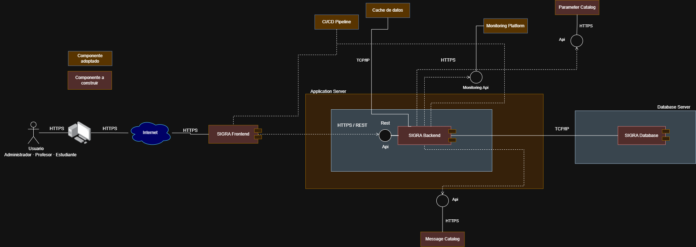
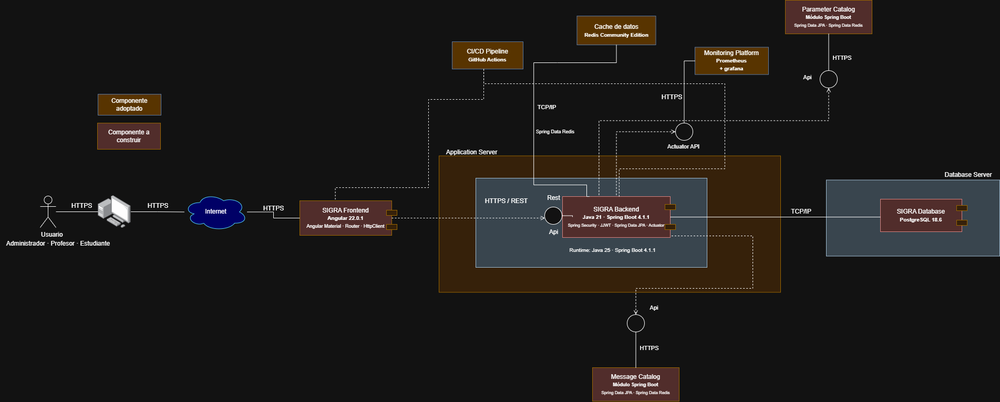
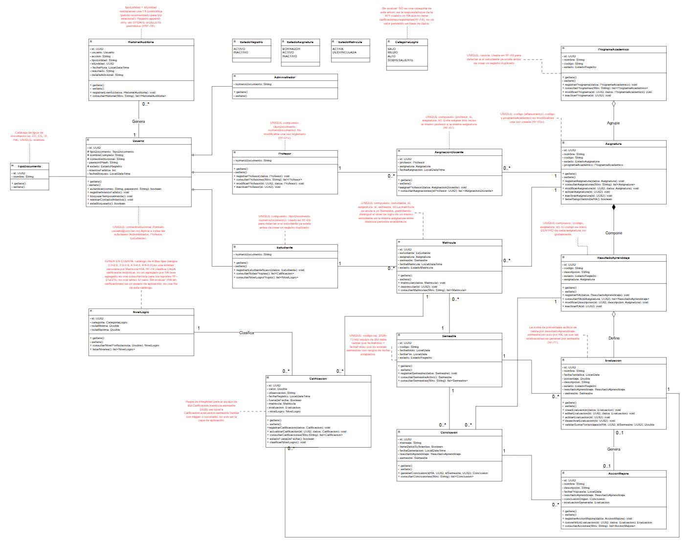
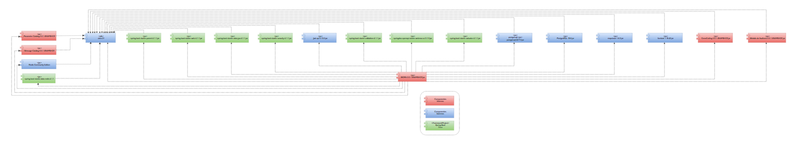
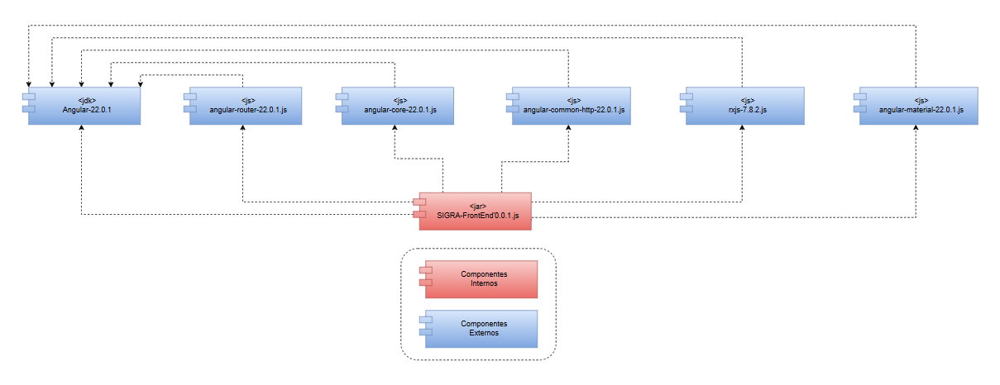

<div align="center">

# SIGRA

### Software Integral de Gestión de Resultados de Aprendizaje

**Backend**

Ingeniería de Software IV · Universidad Católica de Oriente
Equipo B · 2026

</div>

---

SIGRA es una plataforma web que permite a una institución educativa definir los Resultados
de Aprendizaje de sus asignaturas, evaluarlos, medir el nivel de logro alcanzado por los
estudiantes y cerrar el ciclo de mejora mediante conclusiones automáticas y acciones
correctivas.

Este repositorio contiene el **backend**: una API REST construida con Spring Boot 4 y
PostgreSQL. El frontend vive en un repositorio aparte.

| | |
| --- | --- |
| **Tecnologías** | Java 21 · Spring Boot 4.1.1 · PostgreSQL · Gradle |
| **Repositorio del frontend** | [software4-SIGRA-frontend](https://github.com/juancabernal/software4-SIGRA-frontend) |
| **Especificación de requisitos** | SRS del equipo, versión vigente |
| **Documentación de análisis y diseño** | [Ver índice](#documentación-del-proyecto) |

> **Cómo navegar este documento.** El índice enlaza a cada apartado. Al final de cada
> apartado de la documentación de análisis y diseño encontrarás una línea de navegación
> para ir al anterior, volver al índice o pasar al siguiente.

---

## Índice

- [1. Integrantes](#1-integrantes)
- [2. Propósito](#2-propósito)
- [3. Funcionalidad por integrante](#3-funcionalidad-por-integrante)
  - [Sprint 1 — Catálogo y seguridad (30/09/2026 – 05/10/2026)](#sprint-1--catálogo-y-seguridad-30092026--05102026)
  - [Sprint 2 — Operación académica (06/10/2026 – 12/10/2026)](#sprint-2--operación-académica-06102026--12102026)
  - [Sprint 3 — Cierre del ciclo y reportes (13/10/2026 – 19/10/2026)](#sprint-3--cierre-del-ciclo-y-reportes-13102026--19102026)
  - [Responsabilidades transversales](#responsabilidades-transversales)
- [4. Empaquetado](#4-empaquetado)
  - [Artefacto](#artefacto)
  - [Estructura de paquetes](#estructura-de-paquetes)
  - [Convención](#convención)
- [5. Arquitectura](#5-arquitectura)
  - [Vista general](#vista-general)
  - [Estilo arquitectónico](#estilo-arquitectónico)
  - [Capas](#capas)
  - [Decisiones transversales](#decisiones-transversales)
  - [Stack](#stack)
- [6. Cómo ejecutar el proyecto](#6-cómo-ejecutar-el-proyecto)
  - [Requisitos previos](#requisitos-previos)
  - [1. Clonar el repositorio](#1-clonar-el-repositorio)
  - [2. Crear el esquema de la base de datos](#2-crear-el-esquema-de-la-base-de-datos)
  - [3. Configurar las variables de entorno](#3-configurar-las-variables-de-entorno)
  - [4. Ejecutar en modo desarrollo](#4-ejecutar-en-modo-desarrollo)
    - [Autenticación (RF-04)](#autenticación-rf-04)
  - [5. Ejecutar las pruebas](#5-ejecutar-las-pruebas)
    - [Pruebas de la API con Bruno](#pruebas-de-la-api-con-bruno)
  - [6. Compilar y ejecutar el JAR](#6-compilar-y-ejecutar-el-jar)
  - [7. Conectar con el frontend](#7-conectar-con-el-frontend)
  - [Problemas frecuentes](#problemas-frecuentes)
- [RF-02 / RF-03 — Autenticación y autorización](#rf-02--rf-03--autenticación-y-autorización)
- [Pendientes conocidos del repositorio](#pendientes-conocidos-del-repositorio)
- [Documentación del proyecto](#documentación-del-proyecto)
  - [Documentos generales](#documentos-generales)
  - [Documentos de análisis y diseño](#documentos-de-análisis-y-diseño)
    - [Visión y estrategia](#visión-y-estrategia)
    - [Historias de usuario](#historias-de-usuario)
    - [Modelo de dominio](#modelo-de-dominio)
    - [Modelado de datos](#modelado-de-datos)
    - [Arquitectura y solución](#arquitectura-y-solución)
    - [Diagramas de clases y componentes](#diagramas-de-clases-y-componentes)
- [Flujo de trabajo con Git](#flujo-de-trabajo-con-git)
  - [Convención de commits](#convención-de-commits)

---

## 1. Integrantes

| Nombre | Rol en el proyecto | Correo |
| --- | --- | --- |
| Juan Camilo Bernal Carmona | Project Manager, Arquitecto y Desarrollador Backend | juan.bernal8928@uco.net.co |
| Jean Paul Ortiz Restrepo | Líder Técnico y Analista de Requisitos | jean.ortiz1424@uco.net.co |
| José Alejandro Valencia | Desarrollador Backend y Base de Datos | jose.valencia1373@uco.net.co |
| Simón Tabares Arias | Analista de Requisitos y Calidad (QA) | simon.tabares2225@uco.net.co |
| Juan José Narváez Marín | Ingeniero de Pruebas (QA/Testing) | juan.narvaez9044@uco.net.co |
| Santiago Torres Castaño | Diseñador UX/UI y Desarrollador Frontend | santiago.torres0381@uco.net.co |
| Andrés Felipe Vélez Alcaraz | Desarrollador Frontend | andres.velez5136@uco.net.co |

Docente y cliente del proyecto: **Luz Mery Ríos Alzate**.

---

## 2. Propósito

SIGRA permite que los profesores evalúen el aprendizaje de sus estudiantes tomando los **Resultados de Aprendizaje (RA)** de cada asignatura como unidad de medida, en lugar de la nota suelta por actividad.

Este repositorio contiene el **backend**: la API REST, el modelo de datos y las reglas de negocio que sostienen el ciclo central del sistema:

> **evaluar → analizar → mejorar → reevaluar**

El backend es responsable de:

- Autenticar usuarios y emitir los tokens de sesión (RF-02).
- Aplicar el control de acceso por rol en cada endpoint, según la Matriz RBAC del SRS (RF-03).
- Mantener el catálogo académico: programas, asignaturas, RA, profesores, estudiantes y semestres (RF-01 a RF-03, RF-06 a RF-09).
- Registrar evaluaciones, calificaciones y observaciones (RF-10 a RF-13).
- Calcular el nivel de logro y las estadísticas descriptivas con **lógica de agregación convencional, sin IA** (RF-14, RF-15).
- Generar conclusiones automáticas y gestionar acciones de mejora (RF-16 a RF-18).
- Conservar un historial de auditoría *append-only* (RF-19, RNF-16).

Queda fuera del alcance del MVP: uso de IA para el análisis, carga de rúbricas en PDF, pasarelas de pago e integraciones con sistemas académicos externos.

---

## 3. Funcionalidad por integrante

### Sprint 1 — Catálogo y seguridad (30/09/2026 – 05/10/2026)

| Integrante | Funcionalidad | Requisitos | Módulo |
| --- | --- | --- | --- |
| José Alejandro Valencia | Inicio de sesión: clase base `Usuario`, catálogo `TipoDocumento`, bcrypt factor 12, JWT HS256 de 60 min, bloqueo de 15 min tras 5 intentos fallidos | RF-02, RNF-10, RNF-17 | `auth` |
| José Alejandro Valencia | Control de acceso por roles: filtro JWT, roles ADMINISTRADOR/PROFESOR/ESTUDIANTE, 401 sin token y 403 sin permiso | RF-03, RNF-13 | `security` |
| Juan Camilo Bernal | Gestión de asignaturas: ciclo Borrador → Activa → Inactiva, código único, activación solo con 5 a 7 RA activos; al inactivar una asignatura se inactivan en cascada sus RA activos | RF-03a–d | `asignaturas` |
| Jean Paul Ortiz | Gestión de profesores: cédula de 6 a 10 dígitos, correo `@uco.net.co`, cédula no modificable, inactivación lógica | RF-01a–d | `profesores` |
| Juan José Narváez | Gestión de Resultados de Aprendizaje: código único por asignatura, tope de 7 RA, mínimo de 5 activos | RF-06a–c | `resultadosaprendizaje` |
| Simón Tabares | Gestión de programas académicos: CRUD con nombre y código únicos y eliminación lógica | RF-02a–d | `programas` |
| Santiago Torres | Gestión de semestres: código único, validación de fechas y rechazo de periodos solapados | RF-Semestre a/b | `semestres` |
| Andrés Vélez | Gestión de estudiantes: `Estudiante` extiende `Usuario`, documento y correo únicos | RF-09a | `estudiantes` |

### Sprint 2 — Operación académica (06/10/2026 – 12/10/2026)

| Integrante | Funcionalidad | Requisitos | Módulo |
| --- | --- | --- | --- |
| Simón Tabares | Asignación docente de asignaturas: asignación masiva, omisión informada de duplicados, servicio «asignaturas del profesor» | RF-07 | `profesores` |
| Andrés Vélez | Matrícula y desvinculación: unicidad (estudiante, asignatura, semestre), repitencia, conservación de calificaciones al desvincular | RF-08, RF-09 | `estudiantes` |
| Juan José Narváez | Gestión de evaluaciones: suma de porcentajes ≤ 100 por (RA, semestre), bloqueo de fecha y % si ya hay notas | RF-10, RF-11 | `evaluaciones` |
| Jean Paul Ortiz | Calificaciones y trazabilidad: nota 0.0–5.0, observación mínima de 10 caracteres, marca `fueraDeFecha` | RF-12, RF-13 | `calificaciones` |
| Santiago Torres | Nivel de logro y estadísticas: catálogo de 4 rangos, recálculo automático, umbral de 3 calificaciones | RF-14, RF-15 | `estadisticas` |
| Juan Camilo Bernal | Conclusiones automáticas: alerta cuando más del 40 % queda en Bajo o Medio, sin duplicar conclusiones vigentes | RF-16 | `estadisticas` |
| José Alejandro Valencia | Historial de auditoría: servicio `registrarEvento`, tabla sin UPDATE ni DELETE, reporte paginado para ADMINISTRADOR | RF-19, RF-21c | `auditoria` |

### Sprint 3 — Cierre del ciclo y reportes (13/10/2026 – 19/10/2026)

| Integrante | Funcionalidad | Requisitos | Módulo |
| --- | --- | --- | --- |
| Juan Camilo Bernal | Acciones de mejora y conversión a evaluación: registro solo con conclusión vigente, validación de % al convertir | RF-17, RF-18 | `mejoras` |
| Santiago Torres | Consultas y reportes por rol: vista del profesor, RA por asignatura, logro por programa, vista del estudiante | RF-20, RF-21a/b, RF-22 | `reportes` |

### Responsabilidades transversales

| Integrante | Responsabilidad |
| --- | --- |
| Jean Paul Ortiz | Setup del repositorio, entornos y pipeline CI |
| Juan José Narváez | Pruebas unitarias y de integración (cobertura ≥ 70 % con JaCoCo en autenticación, RBAC, nivel de logro y conclusiones) |
| Juan José Narváez y José Alejandro Valencia | Pruebas no funcionales (carga, tiempos de respuesta, seguridad) |
| Jean Paul Ortiz y José Alejandro Valencia | Despliegue final |
| Simón Tabares | Aceptación alfa y beta con la docente |
| Juan Camilo Bernal | Cierre y entrega final |

> Cada desarrollador documenta sus propios endpoints en Swagger; la consolidación es una tarea aparte del plan.

---

## 4. Empaquetado

### Artefacto

El proyecto se empaqueta con **Gradle** como un JAR ejecutable de Spring Boot (*fat jar*), que incluye el servidor embebido:

```bash
cd SIGRA
./gradlew clean bootJar
# → SIGRA/build/libs/SIGRA-0.0.1-SNAPSHOT.jar
```

### Estructura de paquetes

El código se organiza por **módulo de negocio** y, dentro de cada uno, por capa. Todos los módulos siguen exactamente la misma forma, de modo que cada integrante trabaja en su carpeta sin colisionar con los demás:

```
SIGRA/
├── build.gradle                  Dependencias y configuración de compilación
├── settings.gradle
├── gradlew / gradlew.bat         Gradle Wrapper
└── src/
    ├── main/
    │   ├── java/co/edu/uco/sigra/
    │   │   ├── SigraApplication.java      Punto de entrada
    │   │   ├── asignaturas/               RF-03
    │   │   ├── auditoria/                 RF-19, RF-21c
    │   │   ├── auth/                      RF-04
    │   │   ├── calificaciones/            RF-12, RF-13
    │   │   ├── estadisticas/              RF-14, RF-15, RF-16
    │   │   ├── estudiantes/               RF-08, RF-09
    │   │   ├── evaluaciones/              RF-10, RF-11
    │   │   ├── mejoras/                   RF-17, RF-18
    │   │   ├── profesores/                RF-01, RF-07
    │   │   ├── programas/                 RF-02
    │   │   ├── reportes/                  RF-20, RF-21a/b, RF-22
    │   │   ├── resultadosaprendizaje/     RF-06
    │   │   ├── semestres/                 RF-Semestre a/b
    │   │   ├── common/                    DTO, excepciones y utilidades compartidas
    │   │   ├── shared/                    Entidades y enums transversales (TipoDocumento, EstadoRegistro)
    │   │   ├── config/                    Configuración transversal
    │   │   └── security/                  RF-05: config y filtros JWT
    │   └── resources/
    │       └── application.yaml
    └── test/java/                Pruebas unitarias y de integración
```

Capas dentro de cada módulo:

| Carpeta | Contenido |
| --- | --- |
| `controller` | Endpoints REST; recibe y valida la petición |
| `dto` | Objetos de entrada y salida de la API |
| `entity` | Entidades JPA que mapean las tablas |
| `exception` | Excepciones propias del módulo |
| `mapper` | Conversión entre entidad y DTO |
| `repository` | Acceso a datos con Spring Data JPA |
| `service` / `service/impl` | Interfaz y reglas de negocio |

### Convención

Ninguna clase de `controller` accede directamente a `repository`: la ruta siempre es **controller → service → repository**. Las validaciones de negocio viven en `service/impl`, no en el controlador.

Los manejadores de excepciones de cada módulo atienden solo errores de negocio de ese módulo y NO incluyen un método para `Exception.class`; los errores comunes (validación, JSON ilegible, 403 por permisos, 500 genérico sin detalles técnicos) los atiende el manejador global en `common/exception`.

---

## 5. Arquitectura

### Vista general

```
┌──────────────────────┐        HTTPS / JSON        ┌──────────────────────────┐
│  SIGRA Frontend      │ ─────────────────────────▶ │  SIGRA Backend           │
│  Angular (SPA)       │ ◀───────────────────────── │  Spring Boot (API REST)  │
│  Admin / Profesor /  │      JWT en Authorization  │                          │
│  Estudiante          │                            └───────────┬──────────────┘
└──────────────────────┘                                        │ JDBC
                                                    ┌───────────▼──────────────┐
                                                    │  PostgreSQL              │
                                                    └──────────────────────────┘
```

SIGRA es un **sistema independiente**: no se integra con SIS, LMS ni pasarelas de pago.

### Estilo arquitectónico

- **Monolito modular por dominio.** Un solo despliegue, dividido internamente en módulos de negocio con fronteras claras. Dado el tamaño del proyecto (4 meses y ~20 usuarios), los microservicios serían sobrediseño.
- **Arquitectura en capas** dentro de cada módulo: controller → service → repository → entity.
- **API REST sin estado.** Cada petición lleva su JWT; el servidor no guarda sesión.

La arquitectura de seguridad definitiva y la integración de los módulos de `develop` están descritas
en [`docs/integracion/main-develop-definitiva-2026-10-16.md`](docs/integracion/main-develop-definitiva-2026-10-16.md).
No se mantienen interceptores ni identidades paralelas de desarrollo: los controladores usan
Spring Security y los servicios fallan cerradamente cuando falta el principal validado.

### Capas

| Capa | Responsabilidad | Tecnología |
| --- | --- | --- |
| Presentación | Endpoints REST, códigos HTTP, validación de entrada | Spring Web MVC, Jakarta Validation |
| Seguridad | Autenticación, filtro JWT, autorización por rol | Spring Security |
| Negocio | Reglas del dominio: rango de 5–7 RA, suma de % ≤ 100, nivel de logro, umbral del 40 % | Servicios Spring |
| Persistencia | Repositorios y mapeo objeto-relacional | Spring Data JPA / Hibernate |
| Datos | Almacenamiento con eliminación lógica y auditoría append-only | PostgreSQL |

### Decisiones transversales

- **Seguridad en dos niveles.** Ocultar una opción en la interfaz nunca basta: cada endpoint valida el rol en el backend según la Matriz RBAC (RF-05, RNF-13). Sin token o con token vencido → `401`; con rol insuficiente → `403`.
- **Nada se borra físicamente.** Programas, asignaturas, RA, profesores y usuarios conservan sus estados
  propios; una matrícula usa `ACTIVA` / `DESVINCULADA` y conserva sus calificaciones históricas.
- **Auditoría append-only.** La tabla de historial no admite `UPDATE` ni `DELETE`, ni siquiera para el administrador; la restricción se impone a nivel de base de datos. Retención mínima: 5 años (RNF-16).
- **Análisis sin IA.** Estadísticas y conclusiones se calculan con agregaciones y reglas de negocio explícitas.
- **Errores sin detalles técnicos.** Los mensajes al usuario no exponen trazas, rutas internas ni consultas SQL (RNF-17).

### Stack

| Componente | Tecnología | Versión |
| --- | --- | --- |
| Lenguaje | Java | 21 (toolchain) |
| Framework | Spring Boot | 4.1.1 |
| Build | Gradle (Wrapper) | — |
| Base de datos | PostgreSQL | 15 o superior |
| ORM | Spring Data JPA / Hibernate | — |
| Seguridad | Spring Security + JWT (HS256) | — |
| Bloqueo de intentos fallidos | Persistido en PostgreSQL (`usuario.intentos_fallidos`, `usuario.fecha_bloqueo`). Redis no se usa | — |
| Validación | Spring Boot Starter Validation | — |
| Monitoreo | Spring Boot Actuator (`/actuator/health`) | — |
| Reducción de boilerplate | Lombok | — |
| Mapeo entidad ↔ DTO | MapStruct | 1.6.3 |
| Pruebas | JUnit 5 + Mockito + MockMvc | — |
| Documentación de API | OpenAPI / Swagger (springdoc) | 3.1.1 |

---

## 6. Cómo ejecutar el proyecto

### Requisitos previos

| Herramienta | Versión mínima | Verificación |
| --- | --- | --- |
| JDK | 21 | `java -version` |
| PostgreSQL | 15 | `psql --version` |
| Redis | 7 — Opcional por ahora (deshabilitado temporalmente) | `redis-cli ping` |
| Git | 2.30 | `git --version` |

No hace falta instalar Gradle: el repositorio incluye el Wrapper (`gradlew`).

### 1. Clonar el repositorio

```bash
git clone https://github.com/juancabernal/software4-SIGRA-backend.git
cd software4-SIGRA-backend/SIGRA
```

> Todos los comandos siguientes se ejecutan desde la carpeta `SIGRA/`, que es la raíz del proyecto Gradle.

### 2. Crear el esquema de la base de datos

SIGRA usa la base `postgres` y el **schema** `sigra` dentro de ella. `sigra` **no es una base de datos**: por eso la URL JDBC lleva `?currentSchema=sigra`.

Para una base vacía, ejecuta el baseline (crea el schema y todas sus tablas en una sola transacción):

```bash
psql -h localhost -p <PUERTO> -U <USUARIO> -d postgres -v ON_ERROR_STOP=1 -f docs/db/SIGRA_SCHEMA_CURRENT.sql
```

Hibernate **no crea ni modifica tablas**: con `ddl-auto=validate` solo comprueba que las entidades coincidan con el esquema. Si falta una tabla o una columna, el backend no arranca. El detalle del modelo (herencia `Usuario` → `Profesor`, correo institucional, deudas) está en [docs/db/SIGRA_DATABASE_CURRENT.md](docs/db/SIGRA_DATABASE_CURRENT.md).

### 3. Configurar las variables de entorno

Nunca subas credenciales al repositorio. La forma recomendada es un archivo `.env` dentro de `SIGRA/`. Spring Boot lo carga de forma nativa (`spring.config.import`) y Git lo ignora (`*.env`):

```bash
cp .env.example .env
```

En PowerShell: `Copy-Item .env.example .env`. Después completa los valores. Las variables reales del sistema (por ejemplo `$env:DB_URL`) tienen prioridad sobre el archivo.

| Variable | Descripción | Valor por defecto | Ejemplo |
| --- | --- | --- | --- |
| `DB_URL` | URL JDBC: base `postgres` y schema `sigra` (`currentSchema`). El puerto depende de tu máquina. Sin valor por defecto | — | `jdbc:postgresql://localhost:5432/postgres?currentSchema=sigra` |
| `DB_USERNAME` | Usuario de la base de datos. Sin valor por defecto | — | `postgres` |
| `DB_PASSWORD` | Contraseña de la base de datos. Sin valor por defecto | — | — |
| `SERVER_PORT` | Puerto HTTP del backend | `8080` | `8080` |
| `JWT_SECRET` | Clave de firma HS256 de al menos 32 bytes. Sin valor por defecto | — | — |
| `JWT_EXPIRATION_MS` | Vigencia del token en milisegundos (debe ser mayor que cero) | `3600000` (60 min) | `3600000` |
| `CORS_ALLOWED_ORIGINS` | Orígenes del frontend, separados por coma | `http://localhost:4200` | `http://localhost:4200` |
| `JPA_DDL_AUTO` | Estrategia de Hibernate. `validate` solo comprueba el esquema; Hibernate nunca lo modifica | `validate` | `validate` |
| `JPA_SHOW_SQL` | Mostrar las consultas SQL en consola | `false` | `false` |

> **Puerto de PostgreSQL:** cada desarrollador usa el puerto de su propio servidor. Por ejemplo, en la máquina de referencia de este proyecto el servidor escucha en `localhost:5433`, así que allí `DB_URL` es `jdbc:postgresql://localhost:5433/postgres?currentSchema=sigra`. El puerto **no está fijado en el código**: se configura en `SIGRA/.env` o en las variables del sistema. El `.env.example` compartido muestra `5432`, que es el valor por defecto de PostgreSQL.

En Linux o macOS:

```bash
export DB_URL="jdbc:postgresql://localhost:5432/postgres?currentSchema=sigra"
export DB_USERNAME=postgres
export DB_PASSWORD=cambiar_esta_clave
export SERVER_PORT=8080
export JWT_SECRET=una_clave_larga_y_aleatoria_de_al_menos_32_caracteres
export JWT_EXPIRATION_MS=3600000
```

En Windows (PowerShell):

```powershell
$env:DB_URL="jdbc:postgresql://localhost:5432/postgres?currentSchema=sigra"
$env:DB_USERNAME="postgres"
$env:DB_PASSWORD="cambiar_esta_clave"
$env:SERVER_PORT="8080"
$env:JWT_SECRET="una_clave_larga_y_aleatoria_de_al_menos_32_caracteres"
$env:JWT_EXPIRATION_MS="3600000"
```

### 4. Ejecutar en modo desarrollo

Linux / macOS:

```bash
./gradlew bootRun
```

Windows:

```powershell
.\gradlew.bat bootRun
```

La API queda disponible en **http://localhost:8080**.

| Recurso | URL |
| --- | --- |
| Estado del servicio | http://localhost:8080/actuator/health |
| Documentación Swagger (UI) | http://localhost:8080/swagger-ui.html |
| Contrato OpenAPI (JSON) | http://localhost:8080/v3/api-docs |

Guías de documentación OpenAPI por módulo:

- [Autenticación JWT](docs/documentacion_openapi/swagger-autenticacion.md)
- [Historial de auditoría](docs/documentacion_openapi/swagger-auditoria.md)
- [Profesores](docs/documentacion_openapi/swagger-profesores.md), [Estudiantes](docs/documentacion_openapi/swagger-estudiantes.md) y [Matrículas](docs/documentacion_openapi/swagger-matriculas.md)

#### Autenticación (RF-04)

`POST /api/v1/auth/login` es público: no requiere token ni cabecera CSRF.

```json
{
  "correoInstitucional": "profesor.bruno@uco.net.co",
  "contrasena": "PasswordSeguro123*"
}
```

| Código | Cuándo |
| --- | --- |
| 200 | Credenciales válidas. Devuelve `token` (JWT HS256 con los claims `sub`, `correo`, `rol`, `iat`, `exp`), `tipo` (`Bearer`), `expiraEn` (segundos) y `usuario` |
| 400 | Datos inválidos: correo vacío o de otro dominio que no sea `@uco.net.co`, o contraseña vacía |
| 401 | Correo o contraseña incorrectos, o usuario inactivo. Es el mismo mensaje en todos los casos |
| 423 | Usuario bloqueado durante 15 minutos tras 5 intentos fallidos |

El correo se acepta sin distinguir mayúsculas y con espacios laterales; el servidor lo normaliza antes de buscarlo. El token vence a los 60 minutos.

### 5. Ejecutar las pruebas

```bash
./gradlew test                            # Pruebas unitarias y de capa web (sin PostgreSQL)
./gradlew integrationTest                 # Pruebas de integración (requiere PostgreSQL y SIGRA/.env)
./gradlew test --tests '*auth*'           # Solo las pruebas de un módulo (ejemplo)
./gradlew test jacocoTestReport           # Pruebas + reporte de cobertura (disponible cuando se agregue el plugin de JaCoCo)
```

Las pruebas se separan por etiqueta para saber siempre qué se ejecutó:

| Tarea | Qué incluye | Requiere PostgreSQL |
| --- | --- | --- |
| `test` | Unitarias y de capa web: servicios, entidades, JWT, BCrypt, controladores con MockMvc y la cadena de seguridad real (`SecurityConfig`) | No |
| `integrationTest` | Pruebas con `@Tag("integration")`: `SigraContextIT` levanta el contexto completo | Sí, con `.env` válido |

Las 5 pruebas de integración del módulo Asignaturas (casos, datos y limpieza con prefijo ITG) están en [docs/pruebas/asignaturas-integracion.md](docs/pruebas/asignaturas-integracion.md).

La matriz de pruebas de matrícula y la migración de `fecha_matricula`/`EstadoMatricula` están en
[`docs/pruebas/matricula-integracion.md`](docs/pruebas/matricula-integracion.md) y
[`docs/db/RF08_matricula_fecha_y_estado_migration.sql`](docs/db/RF08_matricula_fecha_y_estado_migration.sql).

Un fallo de `integrationTest` por credenciales o conexión no invalida el resultado de `test`.

El reporte de cobertura quedará en `build/reports/jacoco/test/html/index.html` cuando se agregue el plugin de JaCoCo.

#### Pruebas de la API con Bruno

Además de las pruebas unitarias, el repositorio incluye una colección de pruebas de la API para [Bruno](https://www.usebruno.com) en `bruno/SIGRA/`, con datos de prueba reproducibles. Cómo cargar los datos y ejecutarla: [bruno/README.md](bruno/README.md).

### 6. Compilar y ejecutar el JAR

```bash
./gradlew clean bootJar
java -jar build/libs/SIGRA-0.0.1-SNAPSHOT.jar
```

Para apuntar a otro perfil o puerto:

```bash
java -jar build/libs/SIGRA-0.0.1-SNAPSHOT.jar --spring.profiles.active=prod --server.port=9090
```

### 7. Conectar con el frontend

Levanta el backend en el puerto 8080 y luego el [frontend Angular](https://github.com/juancabernal/software4-SIGRA-frontend) en el 4200. El frontend apunta al backend mediante la variable `apiUrl` de sus archivos de entorno.

### Problemas frecuentes

| Síntoma | Causa probable | Solución |
| --- | --- | --- |
| `Connection refused` a PostgreSQL | El servicio no está arriba o el puerto es otro | Verifica el servicio y el valor de `DB_URL` |
| `Permission denied: ./gradlew` | El script perdió el permiso de ejecución | `chmod +x gradlew` |
| `UnsupportedClassVersionError` | JDK anterior a 21 | Instala JDK 21 y ajusta `JAVA_HOME` |
| `Could not resolve all dependencies` | Primera ejecución sin red o con proxy | Verifica la conexión y vuelve a ejecutar |
| El token se rechaza siempre | `JWT_SECRET` ausente o demasiado corto | Define una clave de 32 caracteres o más |
| `Could not resolve placeholder 'DB_URL'` (o `DB_USERNAME`, `DB_PASSWORD`, `JWT_SECRET`) | No existe `SIGRA/.env` ni la variable está definida en el sistema. Estas variables no tienen valor por defecto | Crea `SIGRA/.env` a partir de `.env.example` y completa los valores |
| `Schema-validation: missing table [...]` o `missing column [...]` al arrancar | La base no tiene el esquema que esperan las entidades (`ddl-auto=validate`) | Ejecuta `docs/db/SIGRA_SCHEMA_CURRENT.sql` en una base vacía, o la migración correspondiente en una base existente. Ver [SIGRA_DATABASE_CURRENT.md](docs/db/SIGRA_DATABASE_CURRENT.md) |
| `relation "usuario" does not exist` o `schema "sigra" does not exist` | `DB_URL` no apunta a `currentSchema=sigra` o el schema no fue creado | Revisa `DB_URL` y ejecuta el baseline |
| `Connection refused` en `localhost:5433` (o `5432`) | El puerto de `DB_URL` no coincide con el de tu PostgreSQL | Corrige el puerto en `DB_URL` dentro de `SIGRA/.env` |
| PowerShell no reconoce `gradlew` | En PowerShell hay que indicar la ruta del script | Ejecuta con `.\gradlew.bat` (con `.\`) |


---

## RF-02 / RF-03 — Autenticación y autorización

**Estado: COMPLETADO (backend para integración frontend).** La autenticación RF-02 y la autorización RBAC RF-03 están activas en la cadena HTTP y en los métodos de los controladores.

| Tecnología | Uso en RF-02/RF-03 |
| --- | --- |
| Spring Security | Cadena de filtros sin estado (`STATELESS`), CSRF deshabilitado para la API REST |
| BCrypt, factor 12 | Hash de contraseñas (`PasswordEncoder`). Nunca se expone el hash |
| JWT HS256 | Token de sesión firmado con `JWT_SECRET` |
| Spring Data JPA / PostgreSQL | Persistencia de `Usuario` (herencia JOINED con `Profesor`) y del contador de intentos |
| Swagger / OpenAPI | Documentación de la API |
| Bruno | Colección de pruebas de la API (`bruno/SIGRA/auth/`) |

**Endpoint:** `POST /api/v1/auth/login` (público).

| Regla | Valor |
| --- | --- |
| Vigencia del JWT | 60 minutos (`JWT_EXPIRATION_MS`, por defecto `3600000`) |
| Intentos fallidos antes de bloquear | 5 consecutivos |
| Duración del bloqueo | 15 minutos. Durante el bloqueo se responde 423 sin evaluar la contraseña |
| Persistencia del contador | Los fallos se guardan aunque la respuesta sea un error (`noRollbackFor`) |
| Mensajes de error | Amigables, sin trazas, SQL ni nombres internos de clases (RNF-17) |

Códigos de respuesta: 200 (login correcto), 400 (validación), 401 (credenciales/token), 403 (rol o alcance), 413 (login mayor de 16 KiB), 423 (bloqueo temporal), 500 (fallo inesperado) y 503 (persistencia no disponible).

**Documentación en ejecución** (con el backend en `localhost:8080`):

- Swagger UI: http://localhost:8080/swagger-ui.html
- Contrato OpenAPI: http://localhost:8080/v3/api-docs
- Estado del servicio: http://localhost:8080/actuator/health

**Variables necesarias:** `DB_URL`, `DB_USERNAME`, `DB_PASSWORD` y `JWT_SECRET` (sin valor por defecto). `JWT_EXPIRATION_MS`, `JPA_DDL_AUTO` y `JPA_SHOW_SQL` tienen valor por defecto. Ver la tabla de la sección 6.

**Notas:**

- Al arrancar, Spring puede mostrar `Using generated security password`. Es un aviso inocuo: SIGRA no usa `UserDetailsService`; la autenticación real es `AuthService` + `PasswordEncoder` + JWT.
- `SecurityConfig` exige autenticación para toda ruta privada (`anyRequest().authenticated()`); la autorización fina se declara con `@PreAuthorize` y el alcance por recurso se comprueba en servicios/repositorios. La etiqueta interna RF-05 de la rama no reemplaza la nomenclatura oficial RF-02/RF-03.

**Deudas que no bloquean RF-02/RF-03** (ver «Pendientes conocidos» más abajo): aprovisionamiento de contraseñas para usuarios creados por API, revocación inmediata de JWT y rate limiting distribuido. `AUTH_RUNTIME_ROLES` quedó resuelta: `Profesor`, `Administrador` y `Estudiante` extienden `Usuario`.

---

## Pendientes conocidos del repositorio

Estado de RF-02/RF-03 (autenticación y autorización) y lo que sigue abierto:

1. **Cédula modificable: contradicción documental.** El diagrama de clases indica que `(tipoDocumento, numeroDocumento)` es una identidad no modificable, pero el criterio de aceptación de RF-01c valida la cédula al modificarla. Mientras el equipo no lo unifique, `modificarProfesor` conserva el comportamiento actual: el número de documento no cambia y el tipo de documento sí.
2. **Concurrencia de intentos fallidos (resuelto).** La búsqueda de usuario aplica bloqueo pesimista y la suite de integración verifica que no se pierdan incrementos bajo concurrencia en PostgreSQL.
3. **Aprovisionamiento de contraseñas (`PASSWORD_PROVISIONING_FLOW`).** `POST /api/v1/profesores` y `POST /api/v1/estudiantes` no reciben contraseña, así que un profesor o un estudiante registrado por la API no puede iniciar sesión todavía (lo mismo aplica a los estudiantes migrados desde el diseño anterior). Decisión: el administrador asigna la contraseña mediante un endpoint propio, `PUT /api/v1/usuarios/{id}/contrasena` (RNF-10: nunca se devuelve ni se registra); pendiente de implementar. Para desarrollo se usan los seeds de Bruno.
4. **Roles en tiempo de ejecución (resuelto).** `Profesor`, `Administrador` y `Estudiante` extienden `Usuario`, así que los tres pueden autenticarse si tienen contraseña (ver el punto 3).
5. **Alineación de esquema.** Si una base tiene `profesor_asignatura` (modelo antiguo) en lugar de `asignacion_docente`, el preflight lo marca como `ALINEACION_ASIGNACIONES_REQUERIDA`. No se renombra ninguna tabla sin revisión del módulo de asignaciones. La base de referencia no lo tiene. Ver `docs/db/RF04_schema_preflight.sql`.
6. **Unicidad de (tipoDocumento, numeroDocumento).** El UNIQUE compuesto del diagrama no puede declararse solo en `profesor`, porque `tipo_documento_id` vive en `usuario`. Se verifica en la migración y en el servicio, pero no como restricción de base de datos.
7. **JaCoCo.** El plugin de cobertura todavía no está declarado, aunque el plan de pruebas exige un 70 % mínimo.
8. **Redis.** Está desactivado temporalmente: comentado en `build.gradle` y `docker-compose.yml`.
9. **Nomenclatura histórica.** La rama se llama `rf-05-security-rbac`, pero la trazabilidad oficial de esta entrega es RF-02 (autenticación) y RF-03 (autorización). El código activo ya exige JWT y aplica `@PreAuthorize`.

---

## Documentación del proyecto

### Documentos generales

| Documento | Ubicación |
| --- | --- |
| Especificación de Requisitos de Software (IEEE 830) | Documento del equipo, versión 2.0 corregida |
| Entendimiento del problema y requisitos funcionales | `docs/requisitos_funcionales/` |
| Matriz RBAC | Apéndice 4.1 del SRS |
| Matriz de compatibilidad de pruebas | Apéndice 4.2 del SRS |
| Plan de pruebas | TestLink |
| Integración definitiva main/develop | `docs/integracion/main-develop-definitiva-2026-10-16.md` |

### Documentos de análisis y diseño

Cada apartado corresponde a una hoja del archivo compartido `documentosAndres/Documentación SIGRA (2).xlsx`. El responsable indicado es quien debe completar aquí su parte (resumen, enlace al documento o archivo embebido); mientras tanto queda marcado como pendiente.

#### Visión y estrategia

##### Visión
**Responsable:** Por definir

_Pendiente de completar._

---
[Índice](#índice) · [Siguiente →](#trade-off)

##### Trade-Off
**Responsable:** Santiago Torres

_Pendiente de completar._

---
[← Visión](#visión) · [Índice](#índice) · [Siguiente →](#mapa-de-empatía)

##### Mapa de empatía
**Responsable:** Andrés Felipe Vélez

El mapa de empatía identifica a los tres actores del sistema (Administrador, Profesor y Estudiante) y pondera los atributos de calidad del SRS según la prioridad que cada uno le da, como insumo para las decisiones de arquitectura y de diseño de la interfaz.

**1. Actores y ponderación de atributos de calidad**

Cada actor calificó de 1 a 9 la importancia de los nueve atributos de calidad del SRS (confiabilidad, disponibilidad, rendimiento, seguridad, usabilidad, eficiencia, flexibilidad, cumplimiento y escalabilidad). La columna *Ponderación Global* normaliza la suma de las tres calificaciones de cada atributo sobre el total de 135 puntos posibles.


**2. Diagrama de radar**

El diagrama de radar compara visualmente el perfil de prioridades de los tres actores: el Administrador se concentra en seguridad y confiabilidad, el Profesor en disponibilidad y usabilidad, y el Estudiante en confiabilidad y seguridad.


**3. Justificación**

La justificación explica, actor por actor, por qué cada atributo de calidad ocupa esa prioridad según su rol en SIGRA:

- **Administrador:** rol de gobierno y control del sistema; prioriza seguridad, confiabilidad y cumplimiento como custodio de la Matriz RBAC y del historial de auditoría.
- **Profesor:** actor operativo principal; prioriza usabilidad, disponibilidad y rendimiento porque usa la plataforma con frecuencia para crear evaluaciones y registrar calificaciones.
- **Estudiante:** rol de consulta sobre su propia información académica; prioriza confiabilidad, seguridad y usabilidad para confiar en los datos que consulta.


---
[← Trade-Off](#trade-off) · [Índice](#índice) · [Siguiente →](#historias-de-usuario-1)

#### Historias de usuario

##### Historias de usuario
**Responsable:** Juan José Narváez

_Pendiente de completar._

---
[← Mapa de empatía](#mapa-de-empatía) · [Índice](#índice) · [Siguiente →](#criterios-de-aceptación)

##### Criterios de aceptación
**Responsable:** Juan José Narváez

_Pendiente de completar._

---
[← Historias de usuario](#historias-de-usuario-1) · [Índice](#índice) · [Siguiente →](#mapa-de-historias-de-usuario)

##### Mapa de historias de usuario
**Responsable:** Por definir

_Pendiente de completar._

---
[← Criterios de aceptación](#criterios-de-aceptación) · [Índice](#índice) · [Siguiente →](#modelo-de-dominio-1)

#### Modelo de dominio

##### Modelo de dominio
**Responsable:** Juan Camilo Bernal

El modelo de dominio describe los conceptos del negocio y las relaciones entre ellos, con
independencia de cómo se almacenen. Es el vocabulario común del equipo: los nombres que
aparecen aquí son los que se usan en el código, en la base de datos y en el SRS.


**Cómo leerlo.** El ciclo central de SIGRA se recorre de izquierda a derecha: una
**Asignatura** agrupa entre 5 y 7 **Resultados de Aprendizaje**; sobre cada RA el profesor
define **Evaluaciones** enmarcadas en un **Semestre**; cada evaluación recibe
**Calificaciones** de los estudiantes matriculados; de esas calificaciones se deriva un
**NivelLogro**; cuando el desempeño agregado resulta insuficiente se genera una
**Conclusión**, que habilita el registro de una **AcciónMejora**, la cual a su vez puede
convertirse en una nueva Evaluación y cerrar el ciclo.

Alrededor de ese núcleo están los actores (**Administrador**, **Profesor**, **Estudiante**,
todos con un **TipoDocumento**), las asociaciones que los vinculan con las asignaturas
(**ProfesorAsignatura** y **Matrícula**) y el **HistorialAuditoría**, que registra los
eventos relevantes sobre todas las entidades.

**Diferencia conocida entre el modelo y la implementación.** El diagrama representa la
relación entre asignatura y programa académico como una asociación propia,
**AsignaturaPrograma**, que permitiría que una asignatura perteneciera a varios programas.
La implementación resolvió esa relación como una clave foránea directa en la asignatura:
cada asignatura pertenece a exactamente un programa académico, conforme a RF-03a, que pide
registrar "el programa académico al que pertenece". La tabla intermedia no existe en el
esquema. El MER refleja la decisión implementada.

---
[← Mapa de historias de usuario](#mapa-de-historias-de-usuario) · [Índice](#índice) · [Siguiente →](#objetos-de-dominio)

##### Objetos de dominio
**Responsable:** Juan Camilo Bernal

Catálogo de los objetos que componen el modelo de dominio, con la definición acordada por
el equipo para cada uno.

| Objeto | Descripción |
| --- | --- |
| **AcciónMejora** | Medida correctiva que el profesor registra sobre un Resultado de Aprendizaje cuando existe una Conclusión insuficiente vigente, y que puede dar origen a una nueva evaluación. |
| **Administrador** | Persona encargada de gestionar el catálogo académico (profesores, programas, asignaturas y RA) y de consultar los reportes de supervisión del sistema. |
| **Asignatura** | Materia dictada dentro de un programa académico, que agrupa entre 5 y 7 Resultados de Aprendizaje y pasa por los estados Borrador, Activa e Inactiva. |
| **Calificación** | Nota (0.0 a 5.0) y observación obligatoria que el profesor registra para un estudiante en una evaluación específica. |
| **Conclusión** | Alerta automática que se genera cuando más del 40 % de los estudiantes obtiene un Nivel de Logro Bajo o Medio en un mismo Resultado de Aprendizaje. |
| **Estudiante** | Persona matriculada en una o varias asignaturas, cuyo aprendizaje es evaluado por RA y que solo tiene acceso de lectura a sus propios resultados. |
| **Evaluación** | Actividad definida por el profesor (nombre, fecha tentativa, porcentaje y descripción) mediante la cual se mide el desempeño de los estudiantes en un Resultado de Aprendizaje. |
| **HistorialAuditoría** | Registro histórico, de solo escritura (*append-only*), de los cambios y eventos relevantes ocurridos sobre las entidades académicas. |
| **Matrícula** | Relación entre un estudiante y una asignatura en un periodo determinado, indicando si la vinculación está Activa o Desvinculada. |
| **NivelLogro** | Categoría (Bajo, Medio, Alto o Sobresaliente) que resulta de calcular el desempeño de un estudiante en un Resultado de Aprendizaje a partir de sus calificaciones. |
| **Profesor** | Persona encargada de evaluar el aprendizaje de los estudiantes en las asignaturas que tiene asignadas, mediante la creación de evaluaciones y el registro de calificaciones. |
| **ProfesorAsignatura** | Asignación docente de uno o varios profesores a una o varias asignaturas para su evaluación. |
| **ProgramaAcadémico** | Programa de formación (por ejemplo, Ingeniería de Sistemas) al cual pertenecen una o varias asignaturas. |
| **ResultadoAprendizaje** | Unidad de medida sobre la cual se evalúa el aprendizaje del estudiante dentro de una asignatura; es fijo por asignatura y solo editable por el Administrador. |
| **Semestre** | Periodo académico (con fecha de inicio y fin) respecto al cual se generan y enmarcan las matrículas, evaluaciones y conclusiones. Los RA no varían de un semestre a otro. |
| **TipoDocumento** | Tipos de identificación válidos para un usuario del sistema. |

> **AsignaturaPrograma** aparecía en el modelo original como objeto propio. La
> implementación la resolvió como una clave foránea directa en la asignatura, por lo que
> dejó de ser un objeto del dominio. Ver la nota del [Modelo de dominio](#modelo-de-dominio).

---
[← Modelo de dominio](#modelo-de-dominio-1) · [Índice](#índice) · [Siguiente →](#muestreo-de-datos-de-objetos)

##### Muestreo de datos de objetos
**Responsable:** Juan Camilo Bernal

Para cada objeto del dominio se listan sus atributos, el significado de cada uno y un dato
de ejemplo. Los identificadores se muestran como UUID abreviados por legibilidad.

> Los objetos **Asignatura**, **Conclusión** y **AcciónMejora** corresponden a RF-03, RF-16,
> RF-17 y RF-18, y se documentan aquí tal como quedaron implementados. El resto refleja el
> modelo acordado por el equipo.

#### AcciónMejora

| Atributo | Descripción | Ejemplo |
| --- | --- | --- |
| Id | Identificador único de la acción de mejora. | `9f1c…4a7b` |
| ConclusiónOrigen | Conclusión vigente que habilitó el registro de la acción. | `3b22…c019` |
| ResultadoAprendizaje | RA sobre el cual se propone la acción. | `7c44…e501` |
| EvaluaciónGenerada | Evaluación creada al convertir la acción. Vacío mientras no se haya convertido. | `No aplica` |
| Nombre | Nombre corto de la acción (hasta 30 caracteres). | `Taller de refuerzo` |
| Descripción | Detalle de la acción propuesta (hasta 100 caracteres). | `Taller práctico adicional sobre límites al infinito y continuidad` |
| FechaPropuesta | Fecha y hora en que se registró la acción. | `2026-03-02 09:14` |

> La acción no tiene un atributo de estado. Que esté convertida o no se deduce de
> **EvaluaciónGenerada**: mientras esté vacío, la acción puede editarse; una vez tiene
> valor, el sistema rechaza tanto una segunda conversión como la edición (RF-17, RF-18).

#### Administrador

| Atributo | Descripción | Ejemplo |
| --- | --- | --- |
| Id | Identificador único del administrador. | `1a2b…4c5d` |
| TipoDocumento | Tipo de documento de identidad. | `Cédula de Ciudadanía` |
| NúmeroDocumento | Número de identificación. | `43215678` |
| NombreCompleto | Nombre y apellidos. | `Luz Mery Ríos Alzate` |
| CorreoInstitucional | Correo con el que accede a la plataforma. Único. | `luzmery.rios@uco.net.co` |
| Estado | Condición actual dentro de la plataforma. | `Activo` |
| PasswordHash | Clave cifrada con bcrypt factor 12. | `$2a$12$xR3p…` |
| IntentosFallidos | Intentos de inicio de sesión fallidos consecutivos. | `0` |
| FechaBloqueo | Fecha hasta la cual la cuenta permanece bloqueada. | `No aplica` |

#### Asignatura

| Atributo | Descripción | Ejemplo |
| --- | --- | --- |
| Id | Identificador único de la asignatura. | `b0d0…0001` |
| Código | Código único de la asignatura, de 3 a 20 caracteres, en mayúsculas. | `MAT-301` |
| Nombre | Nombre de la asignatura, de 3 a 100 caracteres. | `Cálculo Diferencial` |
| ProgramaAcadémico | Programa al que pertenece la asignatura. | `Ingeniería de Sistemas` |
| Estado | Condición actual: Borrador, Activa o Inactiva. | `ACTIVA` |

> El código y el programa académico no son modificables una vez creada la asignatura
> (RF-03c). Solo el nombre puede actualizarse.

#### Calificación

| Atributo | Descripción | Ejemplo |
| --- | --- | --- |
| Id | Identificador único de la calificación. | `5e60…b112` |
| Evaluación | Evaluación a la que pertenece la calificación. | `2f81…9ac3` |
| Matrícula | Matrícula del estudiante en la asignatura. | `c0a0…00b1` |
| Valor | Nota obtenida, entre 0.0 y 5.0. | `4.2` |
| Observación | Comentario obligatorio del profesor (mínimo 10 caracteres). | `Buen manejo de propiedades algebraicas, revisar límites al infinito` |
| FechaRegistro | Fecha en que se registró la calificación. | `2026-02-16` |
| FueraDeFecha | Indica si se registró después de la fecha tentativa de la evaluación. | `No` |

#### Conclusión

| Atributo | Descripción | Ejemplo |
| --- | --- | --- |
| Id | Identificador único de la conclusión. | `e400…0001` |
| ResultadoAprendizaje | RA sobre el cual se generó la conclusión. | `7c44…e501` |
| Semestre | Semestre en el que se generó. | `e300…0001` |
| Mensaje | Texto generado automáticamente según la regla de RF-16. | `Nivel de logro insuficiente en RA-01: se recomienda registrar una acción de mejora` |
| TieneDatosSuficientes | Indica si había datos suficientes para concluir. | `Sí` |
| PorcentajeInsuficiente | Porcentaje de estudiantes en nivel Bajo o Medio que originó la conclusión. | `60.0` |
| FechaGeneración | Fecha y hora en que se generó la conclusión. | `2026-03-01 08:00` |
| Estado | Vigente mientras no se registre una acción de mejora; atendida después. | `VIGENTE` |
| TotalEvaluados | Estudiantes con nivel de logro calculado al momento de generarla. | `5` |
| EnNivelBajo | Cuántos de ellos quedaron en nivel Bajo. | `2` |
| EnNivelMedio | Cuántos quedaron en nivel Medio. | `1` |
| UmbralPorcentaje | Umbral aplicado, según RF-16. | `40.0` |
| PorcentajeSemestreAnterior | Mismo porcentaje para el RA en el semestre anterior, si existe. | `35.0` |
| SemestreAnteriorCódigo | Código de ese semestre anterior. | `2026-1` |

> Los seis últimos atributos forman el diagnóstico: se registran al generar la conclusión y
> no se recalculan, de modo que la conclusión conserve la situación del momento en que se
> produjo.

#### Estudiante

| Atributo | Descripción | Ejemplo |
| --- | --- | --- |
| Id | Identificador único del estudiante. | `e000…0011` |
| TipoDocumento | Tipo de documento de identidad. | `Cédula de Ciudadanía` |
| NúmeroDocumento | Número de identificación. | `1000000001` |
| NombreCompleto | Nombre y apellidos. | `Juan Camilo Bernal Carmona` |
| CorreoInstitucional | Correo con el que accede a la plataforma. Único. | `juan.bernal@uco.net.co` |
| Estado | Condición actual dentro de la plataforma. | `Activo` |
| PasswordHash | Clave cifrada con bcrypt factor 12. | `$2a$12$xR3p…` |
| IntentosFallidos | Intentos de inicio de sesión fallidos consecutivos. | `0` |
| FechaBloqueo | Fecha hasta la cual la cuenta permanece bloqueada. | `No aplica` |

#### Evaluación

| Atributo | Descripción | Ejemplo |
| --- | --- | --- |
| Id | Identificador único de la evaluación. | `2f81…9ac3` |
| ResultadoAprendizaje | RA que la evaluación mide. | `7c44…e501` |
| Semestre | Semestre en el que se aplica. | `e300…0001` |
| Nombre | Nombre de la evaluación. | `Parcial 1 — Límites` |
| FechaTentativa | Fecha estimada de aplicación. | `2026-02-15` |
| Porcentaje | Peso dentro del RA. La suma de las activas no puede superar 100 %. | `30.00` |
| Descripción | Contenido o alcance de la evaluación. | `Evaluación escrita sobre límites y continuidad` |
| Estado | Condición actual de la evaluación. | `ACTIVA` |

#### HistorialAuditoría

| Atributo | Descripción | Ejemplo |
| --- | --- | --- |
| Id | Identificador único del registro de auditoría. | `aa10…77f2` |
| TipoUsuario | Rol que ejecutó la acción. | `Profesor` |
| IdUsuario | Identificador del usuario que la ejecutó. | `e000…0001` |
| TipoEntidad | Entidad sobre la que se ejecutó la acción. | `Calificación` |
| IdEntidad | Identificador de la entidad afectada. | `5e60…b112` |
| Acción | Operación realizada. | `Registro fuera de fecha` |
| FechaHora | Momento exacto del evento. | `2026-02-18 09:34:12` |
| Resultado | Desenlace de la operación. | `Éxito` |
| Detalle | Descripción específica de lo ocurrido. | `Calificación registrada 3 días después de la fecha tentativa` |

#### Matrícula

| Atributo | Descripción | Ejemplo |
| --- | --- | --- |
| Id | Identificador único de la matrícula. | `c0a0…00b1` |
| Estudiante | Estudiante matriculado. | `e000…0011` |
| Asignatura | Asignatura en la que se matricula. | `b0d0…0001` |
| Semestre | Periodo académico de la matrícula. | `e300…0001` |
| FechaMatrícula | Fecha en que se realizó la matrícula. | `2026-01-21` |
| Estado | Condición actual: Activa o Desvinculada. | `ACTIVA` |

#### NivelLogro

| Atributo | Descripción | Ejemplo |
| --- | --- | --- |
| Id | Identificador único del nivel de logro. | `d100…0003` |
| Categoría | Nombre de la categoría de desempeño. | `Alto` |
| NotaMínima | Valor mínimo del rango. | `4.0` |
| NotaMáxima | Valor máximo del rango. | `4.5` |

> Los cuatro rangos adoptados en RF-14 son: Bajo 0.0–2.9, Medio 3.0–3.9, Alto 4.0–4.5 y
> Sobresaliente 4.6–5.0.

#### Profesor

| Atributo | Descripción | Ejemplo |
| --- | --- | --- |
| Id | Identificador único del profesor. | `e000…0001` |
| TipoDocumento | Tipo de documento de identidad. | `Cédula de Ciudadanía` |
| NúmeroDocumento | Número de identificación, de 6 a 10 dígitos. | `1098765432` |
| NombreCompleto | Nombre y apellidos. | `Ana Gómez` |
| CorreoInstitucional | Correo del dominio `@uco.net.co`. Único. | `ana.gomez@uco.net.co` |
| Estado | Condición actual dentro de la plataforma. | `Activo` |
| PasswordHash | Clave cifrada con bcrypt factor 12. | `$2a$12$xR3p…` |
| IntentosFallidos | Intentos de inicio de sesión fallidos consecutivos. | `0` |
| FechaBloqueo | Fecha hasta la cual la cuenta permanece bloqueada. | `No aplica` |

#### ProfesorAsignatura

| Atributo | Descripción | Ejemplo |
| --- | --- | --- |
| Id | Identificador único de la asignación docente. | `c0a0…00a1` |
| Profesor | Profesor asignado. | `e000…0001` |
| Asignatura | Asignatura a la que se asigna. | `b0d0…0001` |
| FechaAsignación | Fecha en que se realizó la asignación. | `2026-02-13` |
| Estado | Condición actual de la asignación. | `ACTIVO` |

#### ProgramaAcadémico

| Atributo | Descripción | Ejemplo |
| --- | --- | --- |
| Id | Identificador único del programa académico. | `a0d0…0001` |
| Nombre | Nombre del programa. Único, hasta 100 caracteres. | `Ingeniería de Sistemas` |
| Código | Código único, alfanumérico, de 4 a 10 caracteres. | `ING-SIS` |
| Estado | Condición actual del programa. | `ACTIVO` |

#### ResultadoAprendizaje

| Atributo | Descripción | Ejemplo |
| --- | --- | --- |
| Id | Identificador único del RA. | `7c44…e501` |
| Asignatura | Asignatura a la que pertenece. | `b0d0…0001` |
| Código | Código corto, único dentro de la asignatura. | `RA-01` |
| Descripción | Lo que el estudiante debe lograr. | `Resuelve problemas de límites y continuidad aplicando propiedades algebraicas` |
| Estado | Condición actual del RA. | `ACTIVO` |

#### Semestre

| Atributo | Descripción | Ejemplo |
| --- | --- | --- |
| Id | Identificador único del semestre. | `e300…0001` |
| Código | Código único del periodo. | `2026-2` |
| FechaInicio | Fecha de inicio del periodo. | `2026-07-01` |
| FechaFin | Fecha de finalización del periodo. | `2026-11-30` |
| Estado | Condición actual del semestre. | `ACTIVO` |

#### TipoDocumento

| Atributo | Descripción | Ejemplo |
| --- | --- | --- |
| Id | Identificador único del tipo de documento. | `d000…0001` |
| Nombre | Nombre del tipo de documento. Único. | `Cédula de Ciudadanía` |

---
[← Objetos de dominio](#objetos-de-dominio) · [Índice](#índice) · [Siguiente →](#mockups)

##### Mockups
**Responsable:** Por definir

_Pendiente de completar._

---
[← Muestreo de datos de objetos](#muestreo-de-datos-de-objetos) · [Índice](#índice) · [Siguiente →](#mer)

#### Modelado de datos

##### MER
**Responsable:** Juan Camilo Bernal

El Modelo Entidad-Relación traduce el modelo de dominio a la estructura de la base de datos:
tablas, claves primarias, claves foráneas, restricciones de unicidad y reglas que no pueden
expresarse solo con relaciones.


**Decisiones de modelado que conviene destacar:**

- **Herencia de usuarios.** `Administrador`, `Profesor` y `Estudiante` comparten los
  atributos de autenticación. En la base se resolvió con herencia por tablas unidas: una
  tabla `usuario` con los datos comunes y una tabla por subtipo. El rol de un usuario se
  deduce de la tabla de subtipo en la que está, sin una columna de rol.
- **Asignatura y programa.** La asignatura referencia directamente a un programa académico.
  Ni el código ni el programa son modificables después de creada (RF-03c).
- **Evaluación generada.** `AcciónMejora` referencia opcionalmente a la evaluación que se
  creó al convertirla. Esa referencia vacía es lo que distingue una acción convertible de
  una ya convertida.
- **Coherencia de semestre en las calificaciones.** Una calificación relaciona una matrícula
  con una evaluación, y ambas están enmarcadas en un semestre. El modelo exige que sea el
  mismo semestre en los dos lados, para que no pueda registrarse una nota de un periodo
  sobre la matrícula de otro.
- **Auditoría sin claves foráneas.** `HistorialAuditoría` guarda el identificador del
  usuario y el de la entidad afectada como valores sueltos, sin clave foránea real, para que
  el historial sobreviva a la inactivación de los registros que describe (RF-19).

---
[← Mockups](#mockups) · [Índice](#índice) · [Siguiente →](#entidades)

##### Entidades
**Responsable:** Juan Camilo Bernal

Tablas que componen el Modelo Entidad-Relación. El esquema completo y ejecutable está en
[`docs/db/SIGRA_SCHEMA_CURRENT.sql`](docs/db/SIGRA_SCHEMA_CURRENT.sql); el detalle por
columna, en [`docs/db/SIGRA_DATABASE_CURRENT.md`](docs/db/SIGRA_DATABASE_CURRENT.md).

| Entidad | Descripción |
| --- | --- |
| **acción_mejora** | Medidas correctivas registradas sobre un Resultado de Aprendizaje a partir de una conclusión insuficiente vigente. |
| **administrador** | Subtipo de usuario encargado de gestionar el catálogo académico y supervisar la plataforma. |
| **asignatura** | Materias dictadas dentro de un programa académico, con su código, nombre y estado. |
| **calificación** | Notas y observaciones registradas por un profesor para un estudiante en una evaluación específica. |
| **conclusión** | Alertas automáticas generadas cuando el desempeño en un Resultado de Aprendizaje resulta insuficiente, con el diagnóstico que las originó. |
| **estudiante** | Subtipo de usuario matriculado en asignaturas, cuyo aprendizaje se evalúa por Resultados de Aprendizaje. |
| **evaluación** | Actividades definidas por un profesor para medir el desempeño de los estudiantes en un Resultado de Aprendizaje. |
| **historial_auditoría** | Eventos y cambios registrados sobre las entidades académicas, con fines de trazabilidad. |
| **historial_calificación** | Versiones anteriores de una calificación, conservadas cada vez que se modifica. |
| **matrícula** | Vinculación entre un estudiante y una asignatura en un semestre, con su fecha y estado. |
| **nivel_logro_estudiante** | Nivel de logro calculado para cada estudiante en un RA y semestre, con su promedio ponderado. |
| **profesor** | Subtipo de usuario encargado de crear evaluaciones y registrar calificaciones en sus asignaturas. |
| **asignación_docente** | Asignación de un profesor a una asignatura, con su fecha y estado. |
| **programa_académico** | Programas de formación a los cuales pertenecen las asignaturas. |
| **resultado_aprendizaje** | Unidades de medida sobre las cuales se evalúa el aprendizaje dentro de una asignatura. |
| **semestre** | Periodos académicos, con su código y fechas de inicio y fin. |
| **tipo_documento** | Tipos de documento de identidad disponibles para el registro de usuarios. |
| **usuario** | Datos comunes de autenticación de los tres subtipos de usuario. |

---
[← MER](#mer) · [Índice](#índice) · [Siguiente →](#mr)

##### MR
**Responsable:** Por definir

_Pendiente de completar._

---
[← Entidades](#entidades) · [Índice](#índice) · [Siguiente →](#arquitectura-de-referencia)

#### Arquitectura y solución

##### Arquitectura de referencia
**Responsable:** José Alejandro Valencia

La arquitectura de referencia de **SIGRA (Software Integral de Gestión de Resultados de Aprendizaje)** identifica los bloques de construcción, su responsabilidad, la diferencia entre componentes **adoptados** y **a construir**, y las relaciones necesarias para soportar la aplicación académica. Se plantea una **SPA web** conectada por **HTTPS/REST** con un **backend monolítico modular**, que mantiene la información institucional en **PostgreSQL**. El diseño incorpora capacidades complementarias de parametrización, mensajes, caché, monitoreo e integración continua sin exigir microservicios independientes.



**Convenciones del diagrama:** los bloques de color **ocre** representan componentes **adoptados** (herramientas o plataformas existentes); los de color **vinotinto**, componentes **a construir** específicamente para SIGRA. Las conexiones identifican el tipo de comunicación o integración. Los catálogos se representan como capacidades lógicas: **no implican por sí mismos despliegues separados del backend**.

**Catálogo de bloques de construcción y justificación**

| Componente | Clasificación | Tipo de bloque | Responsabilidad y justificación |
| --- | --- | --- | --- |
| **SIGRA Frontend (Angular)** | A construir | Específico | Interfaz SPA para **Administrador, Profesor y Estudiante**. La propuesta utiliza **Angular 22.0.1**, Angular Router y *guards* por rol para navegación, `HttpClient` para consumir la API REST y Angular Material para interfaz y accesibilidad. Un único frontend reduce la complejidad operativa frente a microfrontends. |
| **SIGRA Backend (Spring Boot)** | A construir | Específico | Concentra la lógica académica y publica una API REST. El arquetipo propone **Java 25 y Spring Boot 4.1.1**, con Spring Security + JWT para autenticación/autorización, Spring Data JPA para persistencia, Bean Validation para entradas y Actuator para observabilidad. Un **monolito modular** resulta suficiente para el volumen y alcance previstos. |
| **SIGRA Database (PostgreSQL)** | Adoptado | Genérico | Fuente de verdad relacional para programas, asignaturas, RA, estudiantes, matrículas, evaluaciones, calificaciones y auditoría. La referencia propone **PostgreSQL 18.6**. Sus transacciones ACID y restricciones mantienen integridad y consistencia sin introducir una base distribuida. |
| **Parameter Catalog** | A construir | Específico | Módulo lógico para centralizar parámetros configurables (por ejemplo, rangos de logro y umbrales). **Spring Data JPA** mantiene los valores en PostgreSQL y **Spring Data Redis** permitiría acelerar lecturas frecuentes cuando la caché esté habilitada. Evita constantes dispersas y admite trazabilidad de cambios. |
| **Message Catalog** | A construir | Específico | Módulo lógico que centraliza mensajes funcionales, de validación y error. La propuesta contempla Spring Boot, **Spring Data JPA** y, de manera opcional, **Spring Data Redis**. Reduce duplicación y facilita el mantenimiento; los textos visuales propios de Angular pueden permanecer en el frontend. |
| **Caché de datos (Redis)** | Adoptado | Genérico | **Redis Community Edition** como caché auxiliar de consultas frecuentes de los catálogos, con TTL e invalidación controlada. **No** reemplaza PostgreSQL y su indisponibilidad no debe impedir consultar la fuente de verdad. No se introduce para resolver una supuesta carga alta. |
| **Monitoring Platform** | Adoptado | Genérico | **Prometheus** recopilaría métricas publicadas mediante Actuator/Micrometer y **Grafana** las mostraría en paneles de disponibilidad, errores y latencia. La arquitectura limita su alcance a métricas y no presupone un sistema adicional de logs o trazas. |
| **CI/CD Pipeline** | Adoptado | Genérico | **GitHub Actions** para automatizar compilación, pruebas y controles de integración del frontend y backend, con trazabilidad de ejecuciones. Aprovecha el repositorio del equipo sin requerir un servidor propio de integración continua. |

Todos los anteriores se consideran **bloques de construcción** del diseño; *específico* significa desarrollado para el dominio SIGRA y *genérico*, tecnología reutilizable. **Adoptado** no significa necesariamente **desplegado o habilitado** en el entorno actual.

**Principios que orientan la selección**

- **Simplicidad:** frontend único y backend monolítico modular, adecuados a un proyecto académico de alcance acotado; se evita la sobrecarga de microservicios.
- **Seguridad por capas:** HTTPS hacia la API, tokens JWT y autorización por rol aplicada en el backend; los *guards* de Angular solo complementan la experiencia de usuario.
- **Consistencia de datos:** PostgreSQL es la fuente de verdad incluso cuando se implemente la caché; las operaciones sensibles utilizan las garantías del motor relacional.
- **Desacoplamiento lógico:** los catálogos son módulos dentro del backend y pueden evolucionar sin introducir servicios ni despliegues adicionales.
- **Operabilidad proporcional:** métricas con Actuator/Prometheus/Grafana y automatización mediante GitHub Actions, sin agregar infraestructura que no justifique el proyecto.

**Documentación de las tecnologías:** [Angular](https://angular.dev/overview) · [Spring Boot](https://spring.io/projects/spring-boot/) · [PostgreSQL](https://www.postgresql.org/about/) · [Spring Data JPA](https://spring.io/projects/spring-data-jpa) · [Spring Data Redis](https://spring.io/projects/spring-data-redis) · [Spring MessageSource](https://docs.spring.io/spring-framework/reference/core/beans/context-introduction.html#context-functionality-messagesource) · [Redis](https://redis.io/) · [Prometheus](https://prometheus.io/docs/introduction/overview/) · [Grafana](https://grafana.com/oss/) · [GitHub Actions](https://docs.github.com/en/actions).

---
[← MR](#mr) · [Índice](#índice) · [Siguiente →](#arquetipo-de-referencia)

##### Arquetipo de referencia
**Responsable:** José Alejandro Valencia

El arquetipo concreta la arquitectura anterior en **tecnologías, interfaces y ubicaciones lógicas**. Representa cómo se comunicarían la aplicación Angular, el servicio Spring Boot, la base de datos y las capacidades complementarias. Es una **propuesta de diseño**, no una certificación de que todos los módulos o servicios estén hoy operativos.



**Tecnologías identificadas en el arquetipo**

| Elemento | Tecnología indicada | Responsabilidad técnica |
| --- | --- | --- |
| Cliente web | **Angular 22.0.1**, Angular Material, Router, `HttpClient` | SPA para los tres roles; consume la API y gestiona navegación y presentación. |
| Servidor de aplicación | **Java 25 / Spring Boot 4.1.1** (versión de Java propuesta en el diagrama) | Ejecuta el backend de SIGRA como un único despliegue modular. |
| Seguridad y datos del backend | **Spring Security, JWT, Spring Data JPA, Actuator** | Autenticación, autorización, mapeo relacional y exposición de indicadores de salud/métricas. |
| Servidor de base de datos | **PostgreSQL 18.6** (versión propuesta en el diagrama) | Persistencia transaccional y fuente de verdad. |
| Caché | **Redis Community Edition / Spring Data Redis** | Caché opcional para las lecturas de los catálogos; comunicación de red TCP/IP. |
| Catálogo de parámetros | **Módulo Spring Boot / Spring Data JPA / Spring Data Redis** | Gestión lógica de parámetros persistidos en PostgreSQL y, cuando se habilite, acelerados con Redis. |
| Catálogo de mensajes | **Módulo Spring Boot / Spring Data JPA / Spring Data Redis** | Mensajes centralizados sin duplicar un despliegue independiente. |
| Monitoreo | **Spring Boot Actuator/Micrometer, Prometheus y Grafana** | Publicación, recopilación y visualización de métricas del servicio. |
| Automatización | **GitHub Actions** | Pipeline de validación y eventual entrega continua desde el repositorio. |

**Flujos e interfaces representados**

1. **Usuario → SIGRA Frontend:** Administrador, Profesor y Estudiante utilizan un navegador y acceden a la aplicación por **HTTPS** a través de Internet.
2. **SIGRA Frontend → SIGRA Backend:** la SPA consume los endpoints por **HTTPS/REST**. El backend autentica los JWT y verifica la autorización en cada operación protegida.
3. **SIGRA Backend → SIGRA Database:** la capa de persistencia utiliza **Spring Data JPA** y el protocolo de red **TCP/IP** para acceder a PostgreSQL.
4. **SIGRA Backend ↔ caché Redis:** integración opcional mediante **Spring Data Redis**; los valores persistentes deben seguir consultándose en PostgreSQL si la caché no está disponible.
5. **Catálogos de parámetros y mensajes:** se muestran interfaces lógicas en el diagrama, pero el diseño los define **dentro del backend**; los enlaces `API`/`HTTPS` no obligan a implementar microservicios.
6. **Backend → plataforma de monitoreo:** la superficie de métricas de **Actuator/Micrometer** puede ser recolectada por Prometheus y visualizada desde Grafana, con acceso protegido según el entorno.
7. **Repositorio → GitHub Actions:** el pipeline aplica compilación, pruebas y validaciones repetibles antes de integrar o desplegar cambios.

**Alcance y diferencia entre la propuesta y el estado del repositorio.** Este arquetipo conserva las versiones que figuran en el material de arquitectura (**Java 25** y **PostgreSQL 18.6**), mientras que el [apartado Stack](#stack) del README documenta actualmente **Java 21 como toolchain** y **PostgreSQL 15 o superior**. Asimismo, la [sección de pendientes](#pendientes-conocidos-del-repositorio) indica que **Redis está deshabilitado temporalmente**. Por tanto, caché, catálogos configurables y plataforma completa de monitoreo deben entenderse como **componentes previstos** cuando no exista verificación explícita de su puesta en marcha. Esta documentación **no modifica** las versiones de compilación, dependencias ni infraestructura existentes.

---
[← Arquitectura de referencia](#arquitectura-de-referencia) · [Índice](#índice) · [Siguiente →](#alternativa-de-solución)

##### Alternativa de solución
**Responsable:** Por definir

_Pendiente de completar._

---
[← Arquetipo de referencia](#arquetipo-de-referencia) · [Índice](#índice) · [Siguiente →](#diagrama-de-clases)

#### Diagramas de clases y componentes

##### Diagrama de clases

**Responsable:** Jean Paul Ortiz

El diagrama de clases de SIGRA representa la estructura estática del sistema, identificando las principales clases del dominio, sus atributos, operaciones y relaciones. Su propósito es mostrar cómo se organizan los elementos académicos y cómo se relacionan los usuarios, las evaluaciones y el seguimiento de los resultados de aprendizaje.



**Cómo leerlo.** El modelo incluye la jerarquía de usuarios (`Usuario`, `Administrador`, `Profesor` y `Estudiante`), los catálogos y estados que apoyan las reglas de negocio, y las entidades que participan en el proceso académico. Entre ellas se encuentran `ProgramaAcademico`, `Asignatura`, `AsignacionDocente`, `Matricula`, `Evaluacion`, `Calificacion`, `ResultadoAprendizaje`, `NivelLogro`, `Conclusion` y `AccionMejora`.

Las asociaciones muestran cómo se vinculan los profesores y estudiantes con las asignaturas, cómo se registran las evaluaciones y calificaciones, y cómo los resultados obtenidos pueden dar lugar a conclusiones y acciones de mejora. `HistorialAuditoria` representa el registro de los eventos relevantes del sistema. Los símbolos de visibilidad permiten distinguir atributos y operaciones públicas, privadas o protegidas, mientras que las multiplicidades indican cuántas instancias pueden participar en cada relación.

**Diferencias conocidas entre el modelo y la implementación.** El diagrama debe interpretarse como un modelo de diseño y contrastarse con el código y el esquema de base de datos vigentes. El README documenta, por ejemplo, que la relación entre asignatura y programa académico se implementa mediante una clave foránea directa en `Asignatura`, y no mediante una entidad intermedia `AsignaturaPrograma`. También registra una diferencia pendiente sobre la modificación del tipo y número de documento de los profesores. Estas diferencias deben mantenerse explícitas hasta que el equipo unifique las decisiones de diseño e implementación.

---
[← Alternativa de solución](#alternativa-de-solución) · [Índice](#índice) · [Siguiente →](#diagrama-de-componentes--back-end)

##### Diagrama de componentes — back end

**Responsable:** Jean Paul Ortiz

El diagrama de componentes del backend presenta la organización de los elementos que conforman los servicios del servidor de SIGRA y las dependencias entre ellos. Representa el componente principal de la API, las tecnologías utilizadas para implementar la lógica de negocio, los módulos internos y los servicios externos de persistencia y caché contemplados en la arquitectura.



**Cómo leerlo.** El componente `SIGRA-Backend` agrupa las funcionalidades del servidor y utiliza Java y Spring Boot como plataforma de desarrollo. Los componentes de acceso web, persistencia, seguridad y validación proporcionan las capacidades necesarias para exponer servicios REST, consultar y guardar información, proteger los endpoints y validar los datos recibidos.

Los componentes propios, como `CrossCutting` y el módulo de auditoría, representan funcionalidades reutilizables y transversales. El diseño también contempla `Parameter Catalog` y `Message Catalog` para centralizar parámetros y mensajes, además de PostgreSQL para la persistencia y Redis como mecanismo de caché previsto para determinadas consultas.

**Alcance de la arquitectura.** El diagrama describe los componentes previstos en el diseño y no implica que todos estén habilitados en el entorno actual. En particular, el README registra que Redis está deshabilitado temporalmente y que PostgreSQL se documenta como versión 15 o superior para el repositorio. Por ello, las versiones y los servicios que aparecen en el diagrama deben contrastarse con las dependencias y la configuración vigentes antes de considerarlos parte de la implementación desplegada.

---
[← Diagrama de clases](#diagrama-de-clases) · [Índice](#índice) · [Siguiente →](#componentes--back-end)

##### Componentes — back end

**Responsable:** Jean Paul Ortiz

El inventario del backend describe los componentes tecnológicos y propios considerados para construir los servicios de SIGRA. Para facilitar su consulta, se presentan su función principal, las dependencias declaradas en el diseño y su clasificación.

| Componente | Función principal | Dependencias declaradas | Tipo |
|---|---|---|---|
| `SIGRA-Backend 0.0.1-SNAPSHOT` | Publica los servicios REST para el catálogo académico, matrícula, evaluaciones, calificaciones, análisis y reportes. | Java 21; Spring Boot 4.1.1 y componentes asociados | Componente a desarrollar |
| Java 21 | Plataforma base de desarrollo del backend. | Plataforma base | Lenguaje/plataforma |
| Spring Boot 4.1.1 | Configura la aplicación y gestiona las dependencias del framework. | Java 21 | Framework |
| `spring-boot-starter-web 4.1.1` | Expone controladores REST y gestiona solicitudes HTTP y respuestas JSON. | Spring Boot 4.1.1 | Framework |
| `spring-boot-starter-data-jpa 4.1.1` | Facilita la persistencia mediante entidades y repositorios. | Spring Boot 4.1.1; PostgreSQL JDBC | Framework |
| `spring-boot-starter-security 4.1.1` | Protege los servicios y aplica autenticación y autorización. | Spring Boot 4.1.1; JJWT | Framework |
| `jjwt-api 0.13.0` | Permite generar y validar tokens JWT. | Java 21 | Librería |
| `spring-boot-starter-validation 4.1.1` | Aplica validaciones a los datos de entrada. | Spring Boot 4.1.1 | Framework |
| `springdoc-openapi-starter-webmvc-ui 3.1.0` | Genera la documentación OpenAPI y proporciona Swagger UI. | Spring Web MVC | Librería de documentación |
| `spring-boot-starter-actuator 4.1.1` | Expone información de salud y monitoreo operacional. | Spring Boot 4.1.1 | Framework |
| `spring-boot-starter-data-redis 4.1.1` | Proporciona integración con Redis para operaciones de caché. | Spring Boot 4.1.1; Redis | Framework |
| PostgreSQL 18.6 | Motor relacional propuesto para almacenar los datos del sistema. | Servicio de base de datos | Servicio externo |
| `mapstruct 1.6.3` | Genera mapeos entre DTO y entidades en tiempo de compilación. | Java 21 | Librería |
| `lombok 1.18.42` | Reduce código repetitivo mediante anotaciones. | Java 21 | Librería |
| `CrossCutting 0.0.1-SNAPSHOT` | Centraliza utilidades compartidas, respuestas estándar y manejo de excepciones. | Java 21 | Componente propio |
| `Módulo de Auditoría 0.0.1-SNAPSHOT` | Registra los eventos relevantes del sistema mediante un historial de auditoría de solo adición. | Spring Data JPA | Componente propio |
| `Parameter Catalog 0.0.1-SNAPSHOT` | Centraliza los parámetros funcionales y configurables de SIGRA. | Spring Data JPA; Spring Data Redis; PostgreSQL; Redis | Componente propio |
| `Message Catalog 0.0.1-SNAPSHOT` | Centraliza mensajes funcionales, de validación y de error. | Spring Data JPA; Spring Data Redis; PostgreSQL; Redis | Componente propio |
| Redis Community Edition | Proporciona caché en memoria para consultas frecuentes a parámetros y mensajes. | Parameter Catalog; Message Catalog | Servicio externo de caché |

**Consideraciones sobre las versiones.** Este inventario conserva las versiones declaradas en la hoja de componentes del Excel. No todas deben interpretarse como dependencias instaladas o servicios activos en el repositorio actual. El README registra Java 21 como *toolchain*, PostgreSQL 15 o superior y Redis temporalmente deshabilitado. Asimismo, la versión de `springdoc-openapi` consignada en el inventario es 3.1.0, mientras que el apartado Stack del README indica 3.1.1. Antes de la entrega final, verifica las versiones efectivas en `build.gradle` y la configuración de infraestructura, y unifica la documentación donde corresponda.

---
[← Diagrama de componentes — back end](#diagrama-de-componentes--back-end) · [Índice](#índice) · [Siguiente →](#diagrama-de-componentes--front-end)

##### Diagrama de componentes — front end

**Responsable:** Jean Paul Ortiz

El diagrama de componentes del frontend representa la aplicación cliente de SIGRA y las principales dependencias utilizadas para construir la interfaz de usuario. El componente principal `SIGRA-FrontEnd` agrupa las funcionalidades de presentación, navegación y comunicación con los servicios del backend.



**Cómo leerlo.** El componente principal se apoya en Angular para construir la aplicación de página única (SPA). Angular Router permite definir rutas y controlar el acceso a las vistas según el rol; Angular Common HTTP gestiona las solicitudes al backend; RxJS facilita el manejo de operaciones asíncronas, y Angular Material proporciona componentes de interfaz basados en Material Design.

El diagrama diferencia los componentes internos de SIGRA de las dependencias externas que apoyan su funcionamiento. La autenticación y autorización efectivas deben seguir siendo verificadas por el backend; los controles de navegación del frontend complementan esta protección, pero no la sustituyen.

**Alcance.** Las versiones mostradas corresponden al inventario de componentes del Excel. Deben contrastarse con el archivo `package.json` y el archivo de bloqueo de dependencias del frontend antes de considerarlas versiones efectivamente instaladas.

---
[← Componentes — back end](#componentes--back-end) · [Índice](#índice) · [Siguiente →](#componentes--front-end)

##### Componentes — front end

**Responsable:** Jean Paul Ortiz

El inventario del frontend describe el componente principal de la aplicación y las bibliotecas que utiliza para construir la interfaz, administrar la navegación y comunicarse con el backend.

| Componente | Función principal | Dependencias declaradas | Tipo |
|---|---|---|---|
| `SIGRA-Frontend 0.0.1` | Aplicación SPA que presenta los módulos para Administrador, Profesor y Estudiante, gestiona la sesión y consume la API. | `@angular/core 22.0.1`; `@angular/router 22.0.1`; `@angular/common/http 22.0.1`; `rxjs 7.8.2`; `@angular/material 22.0.1` | Componente a desarrollar |
| `@angular/core 22.0.1` | Framework base para crear componentes, servicios y gestionar el ciclo de vida de la aplicación. | Base de Angular | Framework |
| `@angular/router 22.0.1` | Gestiona las rutas, la navegación y los guards de acceso a las vistas. | `@angular/core 22.0.1` | Framework |
| `@angular/common/http 22.0.1` | Proporciona el cliente HTTP para consumir los servicios del backend. | `rxjs 7.8.2` | Librería |
| `rxjs 7.8.2` | Facilita el manejo de flujos asíncronos y observables. | — | Librería |
| `@angular/material 22.0.1` | Proporciona componentes visuales basados en Material Design y herramientas de accesibilidad. | `@angular/core 22.0.1` | Framework de interfaz |

**Consideraciones sobre las versiones.** Las versiones anteriores se transcriben del inventario de arquitectura. Deben verificarse con `package.json` y el archivo de bloqueo de dependencias del frontend para asegurar que coincidan con el proyecto implementado. La restricción de acceso por roles debe validarse también en los endpoints del backend, independientemente de los guards del cliente.

---
[← Diagrama de componentes — front end](#diagrama-de-componentes--front-end) · [Índice](#índice)

---

## Flujo de trabajo con Git

Cada integrante trabaja en su propia rama (por ejemplo `bernal` o `jean`) o en una rama `feature/RF-XX-nombre-corto`:

```bash
git checkout bernal
git pull origin develop
# ... desarrollo ...
git commit -m "feat(asignaturas): servicio de registro, modificación y activación/inactivación"
git push origin bernal
```

- **Toda integración se hace por Pull Request hacia `develop`**, revisado por al menos otro integrante.
- Nunca se abre un Pull Request de una rama personal hacia `main`.
- `develop` debe mantenerse siempre estable y compilando.
- `main` se actualiza solo desde `develop`, en las entregas.

### Convención de commits

Se usa [Conventional Commits](https://www.conventionalcommits.org/es/): `tipo(ámbito): descripción`, con los tipos `feat`, `fix`, `test`, `docs`, `chore`, `ci` y `refactor`. Ejemplos reales del repositorio:

```
feat(asignaturas): servicio de registro, modificación y activación/inactivación
fix(asignaturas): al inactivar una asignatura se inactivan en cascada sus RA activos
test(semestres): agregar pruebas unitarias de servicio y controlador
```
